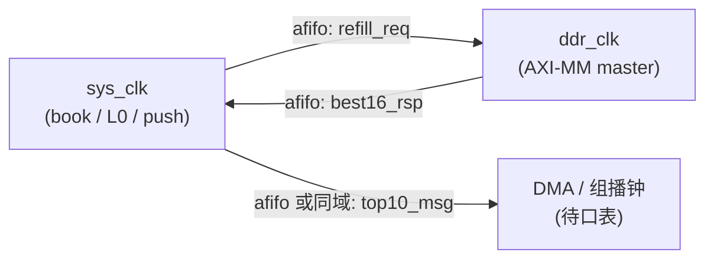

# P1 并行切分草案 — L0×4096 / push 三级 / refill 旁路

日期：2026-09-04  
状态：**设计草案**（并行侧）— **口表回填前不动 RTL**  
依据：`book-push-refill-v2.md`（FROZEN）、`p0-top10-axi-contract.md`  
责任：**并行**维护本契约并审 diff；**码农**落盘 `l0_top10_mem` / `book_push_engine` / refill/snap RTL（见 `p1-push-refill-handoff.md`）

对齐 P0：`rtl/book_pkg.sv` 已冻 `top10_msg_t`（**2080b / 260B**）、`F_TOP10_RT/TIMER/REFILL`。施工单里的 `top10_ram` = 本文件 **`l0_top10_mem`**（同模块，勿双写第二套）。

---

## 0. 本草案钉死什么

| ID | 钉死 |
|---|---|
| P-L0 | L0 按 `symbol_id[1:0]` **4 bank**；热路径独占 Port-A；snap/refill 共享 Port-B |
| P-L0-API | 落盘口：`i_*_req` / `o_*_ready` + `l0_top10_row_t`（施工单 `top10_ram`≡`l0_top10_mem`）。同 bank 冲突：**A 胜，`o_b_ready=0`**（语义 ≡ 原 `o_b_nack`，不回滚） |
| P-L0-B | Port-B 优先级（top 仲裁）：**refill_wr > refill_rd > snap_rd** |
| P-L0-DBG | 建议 `o_dbg_conflict_cnt`（同 bank A/B 冲突计数，非阻塞） |
| P-PUSH | `book_push_engine` 三级队列 **rt > refill > timer**；DMA 反压**只**打 push 侧，不回灌行情 |
| P-REFILL | refill 走旁路：`refill_fifo` → L1 best16 读 → L0 Port-B 写 → `push_q_refill`；**禁止**堵 `cmd_dispatch` |
| P-CDC | `sys_clk`（簿/推送）与 `ddr_clk`（AXI-MM）之间只用 async FIFO；热路径不等 DDR rsp |

口表（DATA_W/ADDR_W/与 DMA 共享）未回填项标 **H-***，见 §8。

---

## 1. 假设清单

| 项 | 取值 | 来源 |
|---|---|---|
| `N_SYM` | 4096 | v2 决议 A |
| L0 行宽 | ≈240B / 标的；打包按实现对齐（建议 256b 多拍或单 URAM 字拼） | v2 §2.1 |
| 主钟 | `sys_clk` ≈ 322 MHz（与现 md 路径同域假设） | v2 / P0 |
| DDR 钟 | `ddr_clk` 独立；AXI 经 async FIFO | P0 §3 |
| 定时 | 10ms 全扫；满推 ~100MB/s；`snap_skip_empty=1` | v2 B |
| 优先级 | 实时推送 > 回补 > 定时；回补不反压行情 | v2 |
| 现网衔接 | 取代 `N_HOT=64` 热门网格 → 全市场常驻；`hot_cam` 退役为可选旁路 | v1 handoff → v2 |
| AXI DATA_W | **假设 512**（待口表） | P0 H |

---

## 2. 时钟域



| 桥 | 宽/内容 | 机制 |
|---|---|---|
| `sys→ddr` refill_req | `{symbol_id, side, seq_start}` | async FIFO，depth≥64 |
| `ddr→sys` best16_rsp | `{symbol_id, side, seq_start, 10×{px,qty,vld}}` | async FIFO |
| push→DMA | `top10_msg_t` 256B 对齐 | 口表定：同域 AXIS 或 afifo |

**铁律：** `cmd_dispatch` / L0 Port-A **永不** `ready` 依赖 DDR rsp 或 DMA `ready`。

---

## 3. 模块树

```
book_push_refill_top          钟/复位、afifo、AXI 壳（口表到了再接）
  book_core                   sys_clk 数据面
    cmd_dispatch              解码 ADD/CXL/TRADE → L0 + L1_cmd fork
    l0_top10_mem              4096×Top-10，4-bank URAM 包装
      l0_bank[4]              每 bank：Port-A=热路径 RMW，Port-B=snap|refill
    order_cache               4k～16k 槽（热路径加减，不每次读 DDR）
    l0_upd_pipe               单标的 Top-10 增量修（读-改-写，2～4 拍）
    snap_fsm                  id=0..4095 轮询；空槽跳过；只走 Port-B
    refill_ctrl               refill_fifo 合并同 symbol；发 req；收 rsp；seq 门禁
    book_push_engine
      push_q_rt               同 symbol 覆盖写；depth 建议 ≥256
      push_q_refill           depth ≥64
      push_q_snap             depth ≥64（可更浅，丢了下轮补）
      push_arb                固定优先级 rt>refill>timer
      push_emit               组 top10_msg；flags 置位
  cdc_afifo_refill_*          跨 ddr_clk
  l1_ddr_engine（既有）        + best16 维护 / BASE_BEST16 读（码农+协议）
```

---

## 4. 数据面连接

```text
  event (sys)
      │
      ▼
 cmd_dispatch ──► l1_cmd ──► l1_ddr_engine ──(ddr)──► AXI / best16
      │                              ▲
      │ Port-A                       │ refill_req (afifo)
      ▼                              │
 l0_upd_pipe ◄── order_cache         │
      │                              │
      │ 写 L0 bank                   │
      ▼                              │
 l0_top10_mem[4bank]                 │
      ▲         ▲                    │
      │Port-B   │Port-B              │
      │         │                    │
 snap_fsm   refill_ctrl ◄── best16_rsp (afifo)
      │         │
      │         │ seq ok → 写 L0 该侧 10 档
      ▼         ▼
   push_q_snap  push_q_refill
      │         │
      │    push_q_rt ◄── L0 任一档变 → 覆盖入队
      ▼         ▼
      └── push_arb ──► push_emit ──► DMA
```

---

## 5. L0 读写口并行度（核心）

### 5.1 为什么 4 bank

- 4096×~240B ≈ 960KB → URAM；单口难同时扛 **热路径 RMW + 10ms 全扫 + refill 写**。
- `bank = symbol_id[1:0]`：同标的永远同 bank → bank 内保序；跨 bank 并行。
- 与现 L1 `N_BANK=4` 习惯一致，仿真/仲裁可复用思路（非同一套 bank）。

### 5.2 双口职责

| 口 | 主人 | 操作 | 反压 |
|---|---|---|---|
| **Port-A** | `l0_upd_pipe`（行情热路径） | 单标的 RMW；可 1R+1W 流水 | 只对 `cmd_dispatch` 短停顿（同 bank 冲突时）；**不对** refill/snap |
| **Port-B** | `port_b_arb`：`refill_wr > snap_rd` | refill：写一侧 10 档；snap：读整标的组包 | 堵在 Port-B 仲裁 / FIFO；**绝不**回灌 Port-A |

同 bank Port-A/B 同拍冲突：Port-A 胜；Port-B **`o_b_ready=0`**（≡ nack），下一拍重试（snap 跳过该拍 / refill 在 `refill_ctrl` 重发写）。

### 5.3 带宽粗算（sys_clk=322M）

| 路径 | 需求 | 口预算 |
|---|---|---|
| 热路径 | 深市峰值按 1 cmd/拍最坏；实际 << | Port-A 独占，足够 |
| 定时扫 | 4096 / 10ms ≈ 0.41M 读/s ≈ **1.3k 拍/s 量级**（相对 322M 极稀） | Port-B 轻松 |
| refill | depth64 队列；随机 DDR 读主导延迟 | Port-B 写偶发 |
| DMA 出 | 满推 ~100MB/s ≈ 0.4 拍/µs @256B | push 侧，不进 L0 |

**结论：** L0 口不是瓶颈；瓶颈在 **DMA 与 AXI 共享带宽**（口表确认后压测）。URAM 综合不过 → **立即回组长**（v2 R1），不在本草案内擅自降 `N_SYM`。

### 5.4 相对 v1 变更点

| v1 | v2 并行侧 |
|---|---|
| `N_HOT=64` + `hot_cam` | `N_SYM=4096` 全常驻；CAM 可关 |
| miss → bypass | 全 symbol 有槽；空槽 `vld=0` |
| 无 push engine | 新增三级 push + emit |
| 无 refill | best16 旁路 + seq 门禁 |

---

## 6. `book_push_engine` 三级队列与背压

### 6.1 队列契约

| 队列 | 入队条件 | 合并策略 | depth 建议 | 满时策略 |
|---|---|---|---|---|
| `push_q_rt` | L0 该标的 Top-10 任一档变 | 同 `symbol_id` **覆盖写最新**（含 seq/ts） | ≥256 | 覆盖已 pending；极端满则丢最旧非本 symbol（计数+告警） |
| `push_q_refill` | refill 写 L0 成功且 seq 门禁通过 | 同 symbol 合并 | ≥64 | 丢最旧 + 计数；可 CSR 强制重填 |
| `push_q_snap` | `snap_fsm` 读出非空标的 | 不合并；被抢占的 id 下轮补 | ≥64 | 丢当前 id，下轮再扫 |

### 6.2 仲裁

```text
if (push_q_rt.not_empty)      grant = RT;
else if (push_q_refill.not_empty) grant = REFILL;
else if (push_q_snap.not_empty)   grant = TIMER;
```

`push_emit`：`fire = grant_valid && dma_ready`；组 `top10_msg_t`，`flags` 置对应 bit。

### 6.3 背压隔离（铁律）

```text
DMA ready↓  → 只停 push_arb / emit
            → 三级队列堆积（rt 靠覆盖吸收突发）
            → L0 / cmd_dispatch / refill_fifo 继续走

refill_fifo 满 → 合并同 symbol；仍满则丢 refill 请求 + 计数（行情不堵）
Port-B 忙     → snap 让拍；refill 重试写；Port-A 无感
```

**禁止：** `l0_upd_pipe` 的 `ready` 看 `push_q_rt` almost_full（若要做安全阀，只允许 **丢弃/覆盖 push**，不许停行情）。

---

## 7. refill 旁路（与热路径隔离）

### 7.1 触发（冻结）

1. CXL/TRADE 后某侧 `top_depth < 10` 且 `l1_may_have_more=1`
2. CSR `refill_symbol`

入 `refill_fifo`：`{symbol_id, side, seq_start}`；同 symbol+side **合并**（保留最新 `seq_start`）。

### 7.2 流水（旁路）

```text
refill_ctrl                   // sys
  → afifo req                 // → ddr
  → l1 读 BASE_BEST16 前 10   // ddr，与热路径 AXI 共享 arb（QoS 待口表）
  → afifo rsp                 // → sys
  → seq 门禁：L0.seq > seq_start ? 丢弃或重入队
  → Port-B 写 L0 该侧 10 档
  → push_q_refill
```

与热路径并行点：

- 行情继续 Port-A 改同一标的时：以 **seq** 为准；旧 refill 结果不得盖新（v2 §4.3）。
- L1 bank 与 L0 bank **无绑定要求**；refill 不占用 Port-A。

### 7.3 不做

- 不做活单扫描回补（决议 C）
- 不在热路径 FSM 里嵌 DDR 等待
- 不把 refill 优先级抬到 rt 之上

---

## 8. 接口表（并行相关箭头）

| 名字 | 方向 | 钟 | 协议 | 反压 | 延迟预算 |
|---|---|---|---|---|---|
| `cmd2l0` | dispatch→upd_pipe | sys | valid/ready + op/symbol/side/px/qty/seq | ready 可低（仅同 bank 冲突） | 1 拍入队 |
| `l0_porta` | upd↔bank | sys | 同步 RAM 口 | 无（内部） | RMW 2～4 拍 |
| `l0_portb` | arb↔bank | sys | 同步 RAM 口 | arb 内部重试 | 写 1～2；读 1～2 |
| `upd2push_rt` | upd→push_q_rt | sys | valid 脉冲；无 ready 回灌 | **忽略** push full（覆盖/计数） | 1 |
| `refill_req` | ctrl→L1 | sys→ddr | afifo | FIFO 满丢+计 | 跨钟不确定 |
| `best16_rsp` | L1→ctrl | ddr→sys | afifo | 同左 | 跨钟 |
| `push_grant` | arb→emit | sys | valid/ready↔DMA | **仅**此处看 DMA | 1+组包 |
| `emit2dma` | emit→DMA | 待口表 | AXIS/`top10_msg` | DMA ready | 口表定 |

---

## 9. 延迟预算（sys 拍，不含 DDR RTT）

| 段 | 拍 |
|---|---|
| cmd → L0 RMW 完成 | 2～4 |
| L0 变 → 入 push_q_rt | +1 |
| push_arb 空载 → emit fire | +1～2 |
| **热路径推送（队列空、DMA ready）** | **≈4～7 拍** |
| refill：sys 侧门禁+写 L0+入队 | 3～5（**另加** DDR RTT，不计入热路径） |
| snap 单标的读+入队 | 2～3 |

---

## 10. 文件清单（口表冻结后才建）

| 文件 | 职责 |
|---|---|
| `docs/p1-parallel-partition.md` | 本草案 |
| `rtl/book_pkg.sv` | `N_SYM`、`top10_msg_t`（与 P0 对齐） |
| `rtl/l0_top10_mem.sv` | 4-bank 双口包装 |
| `rtl/l0_upd_pipe.sv` | 热路径 RMW |
| `rtl/snap_fsm.sv` | 定时扫 |
| `rtl/refill_ctrl.sv` | 旁路 + seq |
| `rtl/book_push_engine.sv` | 三级队列 + arb + emit |
| `rtl/book_push_refill_top.sv` | 集成 / CDC |
| 改：`book_engine.sv` / `l1_ddr_engine.sv` | fork 与 best16 读（码农） |

---

## 11. 未决权衡（≤3，等口表/综合）

| ID | 问题 | 选项 | 默认倾向 |
|---|---|---|---|
| H1 | L0 行在 URAM 内如何切字 | (a) 每标的多拍拼 240B  (b) 宽字单拍（多 URAM 并行） | (a) 省口；(b) 降 RMW 拍数 — **综合后选** |
| H2 | DMA 与 AXI-MM 是否同口争用 | 共享 vs 独立 | 共享则 timer 周期可拉长；**等 AXI 口表** |
| H3 | `push_q_rt` 满策略 | 覆盖-only vs 允许短暂停 L0（禁止） | **覆盖-only + 计数** |

---

## 12. 给下游的一句话

- **组长：** 并行切法按 4-bank 双口 + 三级固定优先级 + refill 旁路；吞吐风险在 DMA/AXI 不在 L0 口。  
- **AXI 协议：** 请回填口表 H2；refill 读 best16 建议 outstanding≥4，且勿把 QoS 设成能堵 `sys` 热路径（热路径本就不等 rsp）。  
- **码农：** 口表到齐后按 §10 落文件；先 `l0_top10_mem` + `book_push_engine` 空 DMA sink 仿真。  
- **验证：** P2 压 rt 突发 + 10ms 满推 + refill 竞态（seq）三并发。
