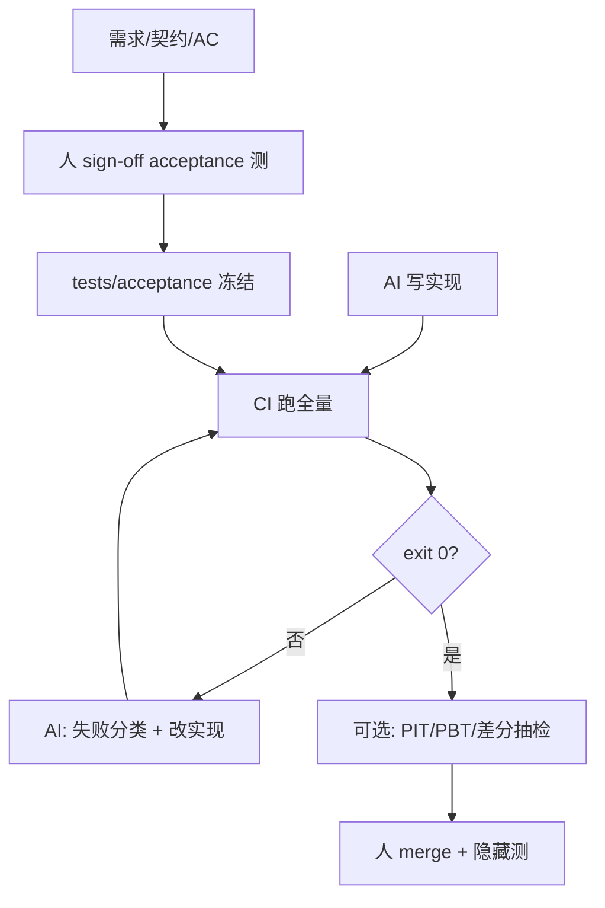

# AI 跑自动化测试验证「按需求写出代码」的正确性

**Asia/Shanghai 2026-09-17 09:40（收紧修订）** · 仓 [Research_everything](https://cursor.com/codebase/melon5253/Research_everything) · 目录 `ai-automated-test-verify-code-20260917-0940/`

---

## 结论摘要（≤10 行）

1. **禁止混写「AI 自动测一下」** — 须拆为三阶段：**需求→可执行断言** → **测试执行（CI/Agent 跑测）** → **结果判定（log/覆盖率/码测归因）**；详见 §3。
2. **默认落地组合（推断，绑 S2,S3,S5）：** **契约/人工 acceptance 用例作 oracle** + **CI 确定性执行** + **AI 仅补测 scaffold 与失败分类**；**禁止**同模型自写实现、自写测、自签字通过。
3. **必须人审：** acceptance 首版 sign-off；Agent 新增 assertion；需求模糊/无 oracle/UI 位图；安全合规路径；Agent 开的 fix PR（S7,S11）。
4. **循环证明风险（事实，S2,S7）：** 同 AI 写码又写测 → 绿测 ≠ 符合需求；缓解 = 独立 oracle、Test/Repair 角色分离、交叉模型、变异/PBT、人工门槛。
5. **主瓶颈是断言质量（事实，S1）：** 人写 reproduction 94.3% vs 自生成 68.0%（SWE-Bench Verified）；BTR=0 时 93.3%。
6. **假绿机制：** 同轨迹共谋（61.2%→57.3%，S2）；LLM oracle 锚定实现（<50%，S7）。
7. **提置信：** qualified/BTR=0 测、差分、PBT+人工 rubric、PIT 评强度 — **不能替代**隐藏验收测。
8. **FPGA/RTL：** 另节 §8；cocotb+sim ≠ 软件单测，默认不等同 pytest 层（S15,S16）。
9. **Out：** 训练微调、IDE 产品设计长文、未核实 ns/准确率编造、与验证无关的纯生成技巧。
10. **证据：** [`sources.md`](sources.md) S1–S18；[`evidence/`](evidence/) E1–E6。

---

## 一页纸速览

> 独立文件：[`onepager.md`](onepager.md)

| 项 | 内容 |
|----|------|
| 三阶段 | 断言化 → 执行 → 判定 |
| 默认组合 | 契约/AC oracle + CI 执行 + AI 补测/分类 |
| 禁止 | 同模型自测自证签字 |
| 人审门槛 | AC sign-off、新 assertion、模糊需求、fix PR |
| 循环证明 | §4 专节 + E2,E5 |
| 对比维 | §6 冻结八维 + E6 |

---

## 0. 假设与口径（先写）

| 参数 | 假定 | 标注 | 出处 |
|------|------|------|------|
| **语言/栈** | Python / Java / TS 为主；含可选 Verilog+cocotb | 假设 | 用户范围 |
| **已有测试框架** | pytest、Jest、Maven Surefire、cocotb Makefile 至少其一 | 假设 | S3 |
| **需求形态** | 自然语言 AC、OpenAPI/接口契约、用例表；issue 作弱规格 | 假设 | S3,S16 |
| **能否上 CI** | 有 GitHub Actions 或等价 CI；可设 `CURSOR_API_KEY` | 假设 | S4,S5 |
| **FPGA/RTL** | **默认不含**；若含则走 §8 仿真链，**不**默认等同软件单测 | 假设 | S15 |
| **同模型写码写测** | 产品默认允许（S3）；本报告**生产默认禁止**自签 | 推断 vs 事实 | S3,S2 |
| **Agent 改测政策** | acceptance/冻结测不可改；可改 setup/fixture | 推断 | S1,S2 |

**待核实：** 团队级「Agent 能否改 assertion」无统一 primary；UI 视觉回归阈值无本报告 primary。

---

## 1. 范围（In / Out）

### In

用**自动化测试**（可含 AI **生成**或**编排**测例）验证「**按需求写出的代码**」是否在**独立 oracle** 下正确的方案，包括：

- 需求→断言、执行、判定三阶段分工  
- 单元 / 集成 / E2E / 属性 / 差分 / 变异测试**选型**  
- Agent loop 与 CI 接入、留证、码错/测错归因  
- FPGA/RTL **仿真**可选对照（cocotb/make sim，非 UVM 全书）

### Out

| 项 | 说明 |
|----|------|
| 从零训练 / 微调模型 | 用户指定 Out |
| 完整 IDE / Cloud Agent **产品设计**长文 | 仅引用 S3,S4 机制 |
| 与验证无关的代码生成技巧 | Out |
| 未核实 ns、编造准确率 | **禁止**写入论断 |
| 完整 UVM 方法论、RTL top 设计、策略语义 | Out |

---

## 2. 问题定义：正确性 vs 看起来能跑

| 概念 | 含义 | 标注 | 出处 |
|------|------|------|------|
| **看起来能跑** | exit 0、CI job 绿、本地 pytest 绿 | 事实 | S3 |
| **正确性** | 在**独立于实现者**的 oracle 下，行为满足需求/契约 | 推断 | S6,S2 |
| **循环证明** | 同一主体写实现+写测+解释通过 | 事实 | S2 |
| **Test hacking** | 改测/skip/硬编码使绿而 issue 未解 | 事实 | S1（7/800） |

---

## 3. 拆清「谁在验证什么」（核心）

> 详表：[`evidence/E5-who-verifies-what-matrix.md`](evidence/E5-who-verifies-what-matrix.md)

### 3.1 需求/规格 → 可执行断言

| 需求形态 | 断言形态 | 谁生成 | 标注 | 出处 |
|----------|----------|--------|------|------|
| Acceptance criteria 列表 | 参数化 `test_*` / `@pytest.mark` | 人优先；AI 起草→**人 sign-off** | 推断 | S3 |
| OpenAPI / 接口契约 | 契约测、schema 校验 | 人/工具；AI 补边界 | 推断 | — |
| GitHub issue | reproduction test | 人 或 Generate Tests+BTR | 事实 | S1 |
| API 文档 | PBT `@given` + 性质 | Agentic PBT | 事实 | S11 |
| CSR / 寄存器表 | cocotb directed + 掩码 | AgentDV 模板 | 事实 | S16 |
| 形式化规格 | **待核实**本报告无 SWE 级 primary | — | 待核实 | — |

**机制行（推断）：** 每条 AC **至少一条**可执行断言；版本与契约文件进 CI artifact。

### 3.2 三职能分离（禁止混写）

| 职能 | 定义 | 典型执行者 | AI 适合 | 不适合 |
|------|------|------------|---------|--------|
| **测试生成** | 产出/补全测源文件 | 人、独立 Test Agent | 补边界、scaffold | **终局 oracle 签字** |
| **测试执行** | 跑命令、收集输出 | **CI runner**、Agent Shell | 触发重跑 | 篡改 exit code |
| **结果判定** | pass/fail、归因、覆盖率 | Harness 规则 + 人 | 失败**分类**、摘要 log |  alone 宣布「需求满足」 |

**事实（S3）：** Cursor 产品将生成与执行耦为 run-and-fix — 生产须叠加 §4 分离策略。

### 3.3 被测对象与「是否同一模型」

| 维度 | 问题 | 稳妥默认 |
|------|------|----------|
| 被测对象 | 按需求**新写**或修改的实现 | 是 |
| 写实现 | Repair / 编码 Agent | 模型 M |
| 写测 | Test Agent 或人 | **≠ M 或人审** |
| 跑测 | CI / Harness | 与 M 无关 |
| 终裁 | 隐藏测 + 人 | 与 M 无关 |

**事实（S2）：** 同轨迹 `(patch, test) ~ π(·|x)` → false confidence。

---

## 4. 循环证明风险（专节）

### 4.1 机制

```text
模型 M 读需求（含误读）→ 写实现 I_M → 写测 T_M（断言常锚定 I_M，S7）
→ 跑 T_M(I_M) 绿 → M 宣称「需求满足」
```

**事实（S2）：** 错 patch + 错测可一致通过；差测甚至使修复率 **61.2%→57.3%**。

**事实（S7）：** LLM oracle 常捕获 **actual** 非 **expected** 行为；分类准确率 **<50%**。

### 4.2 缓解（须组合，标注混合）

| 缓解 | 机制 | 标注 | 出处 |
|------|------|------|------|
| **独立 oracle** | 人工 AC、隐藏 CI 测、OpenAPI | 推断 | S1,S2 |
| **角色分离** | Test agent 写测 → freeze；Repair 只改码 | 事实 | S2 |
| **交叉模型** | Test 用 M′，Repair 用 M | 推断 | S2 用 GPT vs Qwen 测 |
| **变异测试** | PIT 杀 mutant；评测非评需求 | 事实 | S7,S8,S6 |
| **BTR / 金 patch qualify** | 测须在 buggy fail、金 patch pass | 事实 | S1 |
| **人工抽检门槛** | 新 assertion PR 必审；PBT 56% valid 需人筛 | 事实+推断 | S11,S7 |
| **禁止改测过关** | TDFlow 不改 reproduction | 事实 | S1 |

### 4.3 证伪

| 命题 | 结论 | 出处 |
|------|------|------|
| 「同模型绿测 = 需求正确」 | **证伪** | S2,E2 |
| 「LLM assertion = 预期行为」 | **证伪** | S7,E3 |

---

## 5. 闭环方案与机制行

> 每方案回答：**需求→断言 | 谁跑 | 留证 | 码错/测错**

### 5.1 推荐默认：契约/AC oracle + CI 执行 + AI 补测/分类

| 机制项 | 内容 | 标注 | 出处 |
|--------|------|------|------|
| 需求→断言 | 人写 AC → `tests/acceptance/`；OpenAPI → 契约测 | 推断 | S3 |
| 谁跑 | CI `pytest`/`npm test`；Agent **不**替代 CI 终裁 | 推断 | S4,S5 |
| 留证 | GitHub Actions run URL、exit code、JUnit XML、`coverage.xml` | 推断 | S4 |
| AI 角色 | 补 unit scaffold、解析 fail log **分类**（断言/环境/实现） | 推断 | S3 |
| 码错 vs 测错 | 见 §5.6 | 推断 | S1,S2,S8 |
| 同模型自签 | **禁止** | 推断 | S2 |

### 5.2 Cursor run-and-fix（产品默认，需加门禁）

| 机制项 | 内容 | 标注 | 出处 |
|--------|------|------|------|
| 需求→断言 | @file + AC prompt → 生成 `*.test.*` | 事实 | S3 |
| 谁跑 | Agent Auto-run Shell | 事实 | S3 |
| 留证 | 终端 stdout/stderr（本地） | 事实 | S3 |
| 失败 | 改码**或改测** until pass | 事实 | S3 |
| 风险 | 同会话自测自证 | 推断 | S2 |
| CI | `agent -p` 分析 failed run（S4） | 事实 | S4 |

### 5.3 TDFlow（研究：测冻结 + 多 Agent 修码）

| 机制项 | 内容 | 标注 | 出处 |
|--------|------|------|------|
| 需求→断言 | 人写 reproduction 或 Generate Tests | 事实 | S1 |
| 谁跑 | 沙箱跑 fail+回归集 | 事实 | S1 |
| 留证 | Debug One 报告、测试 error 列表 | 事实 | S1 |
| 码错 | Explore Files 改 patch；**不改测** | 事实 | S1 |
| 数字 | 人写 94.3% / 自生成 68.0% | 事实 | S1 Table 2 |

### 5.4 EXECCRITIC（研究：Test/Repair 分离）

| 机制项 | 内容 | 标注 | 出处 |
|--------|------|------|------|
| 需求→断言 | Test agent → behavior contract + test patch | 事实 | S2 |
| 谁跑 | fail-closed harness | 事实 | S2 |
| 留证 | 冻结 bundle + 执行反馈 | 事实 | S2 |
| 测错 | qualify 失败则丢弃测 | 推断 | S2 |
| 终裁 | 官方 hidden evaluator | 事实 | S2 |

### 5.5 性质 / 差分 / 变异（辅助 oracle）

| 类型 | 需求→断言 | 谁跑 | 留证 | 码/测 | 出处 |
|------|-----------|------|------|-------|------|
| PBT | 文档→`@given` 性质 | pytest+Hypothesis | shrink 反例 | 人审 valid（56%） | S11,S12 |
| 差分 | spec+代码 diff→区分输入 | 双二进制 | 区分测列表 | 不一致→至少一侧错 | S13 |
| 变异 | 不改断言；评强度 | PIT | mutation score | 高分≠需求对 | S7,S8 |

### 5.6 码错 vs 测错判定表

| 观测 | 判定 | 下一步 | 出处 |
|------|------|--------|------|
| 仅 buggy 版本 fail，金/官方 patch pass | 测有效 | 冻结测，改实现 | S1,S2 |
| 金 patch 上仍 fail | **测错** | 丢弃或人修测 | S8（fail oracle 丢弃） |
| 改 assertion 后绿、需求方仍拒 | **循环证明** | 独立 oracle + 人审 | S2,S7 |
| 回归集由绿变红 | **码错**（回归） | 回滚或修实现 | S1 |
| PBT shrink 出反例，人工确认 | 可能码错 | 提 issue | S11 |

---

## 6. 冻结对比表（八维）

> 单元格出处：[`evidence/E6-frozen-comparison-dimensions.md`](evidence/E6-frozen-comparison-dimensions.md)

| 方案 | oracle 来源 | 人机门禁 | 同模型自证 | 覆盖层 | 失败定位 | CI 留证 | 成本/幻觉 | 出处 |
|------|-------------|----------|------------|--------|----------|---------|-----------|------|
| **契约+CI（默认）** | AC+契约+隐藏测 | merge 前人审 | **否** | 单+集+隐藏 | log 行号 | URL+JUnit+exit | 低/中 | S3,S4 |
| Cursor run-and-fix | LLM assert | 弱 | **是** | 单测 | stderr | 本地 log | 低/高 | S3 |
| TDFlow 人写测 | 人工 reproduction | 人写测 | 测≠码 Agent | 单+回归 | Debug One | 沙箱 log | 中/中 | S1 |
| EXECCRITIC | 冻结测+隐藏 | evaluator | 角色分离 | repo-native | 执行反馈 | 冻结 bundle | 高/中 | S2 |
| Agentic PBT | 文档性质 | rubric 人审 | 性质≠实现 | PBT | shrink | report | 中/中 | S11 |
| 差分 | 双实现 | 人确认 bug | 可交叉 | 定向 | diff out | 测列表 | 高/中 | S13 |
| CI autofix | **既有 CI** | fix PR 人审 | CI 非 Agent 写 | 同 CI | job log | workflow_run | API/低 | S5 |
| EDA verify | 参考模型 | 人看波形 | Agent TB | **仿真** | triage | VCD/JUnit | 中/中 | S15 |

---

## 7. 默认落地组合与人审门槛

### 7.1 默认组合（推断，绑 S2,S3,S5,S7）



| 层级 | 内容 | AI 可做 | AI 不可做 | 出处 |
|------|------|---------|-----------|------|
| L0 | 冻结 acceptance / 契约测 | 起草 | 改 oracle / 自签 | S2 |
| L1 | 单元 happy+error | 补 scaffold | 削弱 assert | S3 |
| L2 | 集成 1–3 链路 | 生成 draft | 替代 E2E oracle | S3 |
| L3 | PBT/变异/差分 | 跑并报告 |  alone 结案 | S11,S13,S7 |
| L4 | CI 隐藏测 | — | 绕过 | S1,S2 |

### 7.2 何时必须加人审

| 条件 | 原因 | 标注 | 出处 |
|------|------|------|------|
| acceptance 测**首版** | oracle 定义 | 推断 | S3 |
| Agent **新增/改** assertion | <50% 对齐意图 | 事实 | S7 |
| 需求模糊 / 无规格 | 无独立 oracle | 推断 | — |
| 无第二实现、无契约 | 差分/PBT 不足 | 推断 | S13 |
| 仅 UI 位图/mockup | 像素非语义 oracle | 推断 | S3 E2E |
| 安全/支付/合规 | 后果不可接受假绿 | 推断 | — |
| CI autofix / Agent fix PR | 防 test hacking | 推断 | S1,S5 |
| PBT 报 bug | 56% valid，需 rubric | 事实 | S11 |

---

## 8. FPGA / RTL 仿真（独立小节，≠ 软件单测）

> **不**默认等同 pytest 单元测试层；**Out** 完整 UVM 方法论。

| 机制项 | 软件单测 | RTL 仿真 | 出处 |
|--------|----------|----------|------|
| 需求→断言 | AC → assert | CSR 表 / NL spec → cocotb | S16 |
| 谁跑 | pytest | `make sim` / `eda-agent sim` | S15 |
| 留证 | JUnit, coverage.xml | VCD, JUnit, sim log | S15 |
| 覆盖 | 行/分支 | 功能覆盖、toggle（AgentDV） | S16 |
| AI 闭环 | run-and-fix | verify → triage → repair | S15 |

| 实践 | 命令/栈 | 标注 | 出处 |
|------|---------|------|------|
| EDA-Agent | `eda-agent verify rtl.v --max-retries 3` | 事实 | S15 README |
| AgentDV | Verilator+cocotb+CSR suite | 事实 | S16 |
| GoGoTB | cocotb 优于 SV 直出 TB | 事实 | S17 |

**待核实：** 本报告未本地跑通 EDA-Agent；以 S15 README CLI 为准。

---

## 9. 工作示例

### 9.1 单元测失败 → 定位 → 再跑绿（含码测归因）

**场景（推断演示，绑 S3,S2）：** AC「过期卡须拒绝」。

| 步 | 阶段 | 动作 | 执行者 | 留证 |
|----|------|------|--------|------|
| 1 | 断言化 | `test_charge_expired_raises` 入 `tests/acceptance/` | **人 sign-off** | git diff |
| 2 | 执行 | `pytest tests/acceptance -k expired` | CI/Shell | exit=1, stderr |
| 3 | 判定 | `AssertionError: did not raise` → **码错** | Harness | log 摘录 |
| 4 | 执行 | Repair 改 `payment.py`（**不改** acceptance） | Agent | src diff |
| 5 | 执行 | 重跑 pytest | CI | exit=0 |
| 6 | 判定 | 全量+隐藏测 | CI | run URL |

### 9.2 无 oracle：差分 + PBT（禁止同模型自签）

| 步 | 手段 | oracle | 人审 | 出处 |
|----|------|--------|------|------|
| 1 | 差分 vs pandas | 双实现 | 确认差异是否 bug | S13 |
| 2 | Hypothesis 性质 | 文档性质 | rubric | S11 |
| 3 | 禁止 | LLM 读实现写 assert | — | S7 |

---

## 10. CI 接入与留证

| 留证物 | 路径/格式 | 用途 | 出处 |
|--------|-----------|------|------|
| 退出码 | `$?` / Actions step outcome | pass/fail | S4 |
| 日志 | `pytest -v` stdout | 失败分类 | S3 |
| JUnit | `--junitxml=report.xml` | CI 聚合 | 推断 |
| 覆盖率 | `coverage.xml` | 强度参考非 oracle | S6 推断 |
| Run URL | `github.run_id` | 审计 | S5 |
| diff | fix PR commits | 改了码还是测 | S5 |

```yaml
# S5：失败触发 autofix（事实摘录）
cursor-autofix:
  needs: [test]
  if: ${{ failure() }}
  uses: wrowston/ci-autofix/.github/workflows/cursor-autofix.yml@main
```

---

## 11. 风险、证伪、待核实

### 11.1 证伪/边界

| ID | 命题 | 结果 | 出处 |
|----|------|------|------|
| F1 | 同模型绿测=需求正确 | 证伪 | S2,E2 |
| F2 | LLM oracle=预期 | 证伪 | S7,E3 |
| F3 | 多跑测必增益 | 边界 ≈1.25pp | S10,E4 |
| F4 | 高 mutation=需求对 | 边界 | S6,S7 |

### 11.2 待核实

- 形式化规格→断言的 Agent 闭环（无 SWE 级 primary）  
- UI 视觉回归阈值  
- 非 SWE 业务仓泛化  

---

## 12. 决策问题答复

### Q1. 默认闭环（三阶段）

| 阶段 | 谁 | 做什么 |
|------|-----|--------|
| 断言化 | **人/契约**（AI 起草） | AC→冻结测 |
| 执行 | **CI** | 跑全量，留 exit+log+JUnit |
| 判定 | Harness + **人** | 失败分类；AI 只改**实现** |
| 终止 | 隐藏测 + merge 人审 | — |

### Q2. 提置信 vs 假绿

见 §4、§6；**禁止**同模型自签、实现锚定 oracle、仅覆盖率。

### Q3. 默认组合与翻车

- **默认：** §7.1 契约+CI+AI 补测/分类  
- **翻车：** 模糊→AC；无 oracle→差分/PBT；UI→DOM+视觉+人审；测差→人写 reproduction（S1）

---

## 13. 出处

- [`sources.md`](sources.md) S1–S18（≥10，可点击 URL）  
- [`evidence/E1`](evidence/E1-tdflow-excerpt.md)–[`E6`](evidence/E6-frozen-comparison-dimensions.md)
