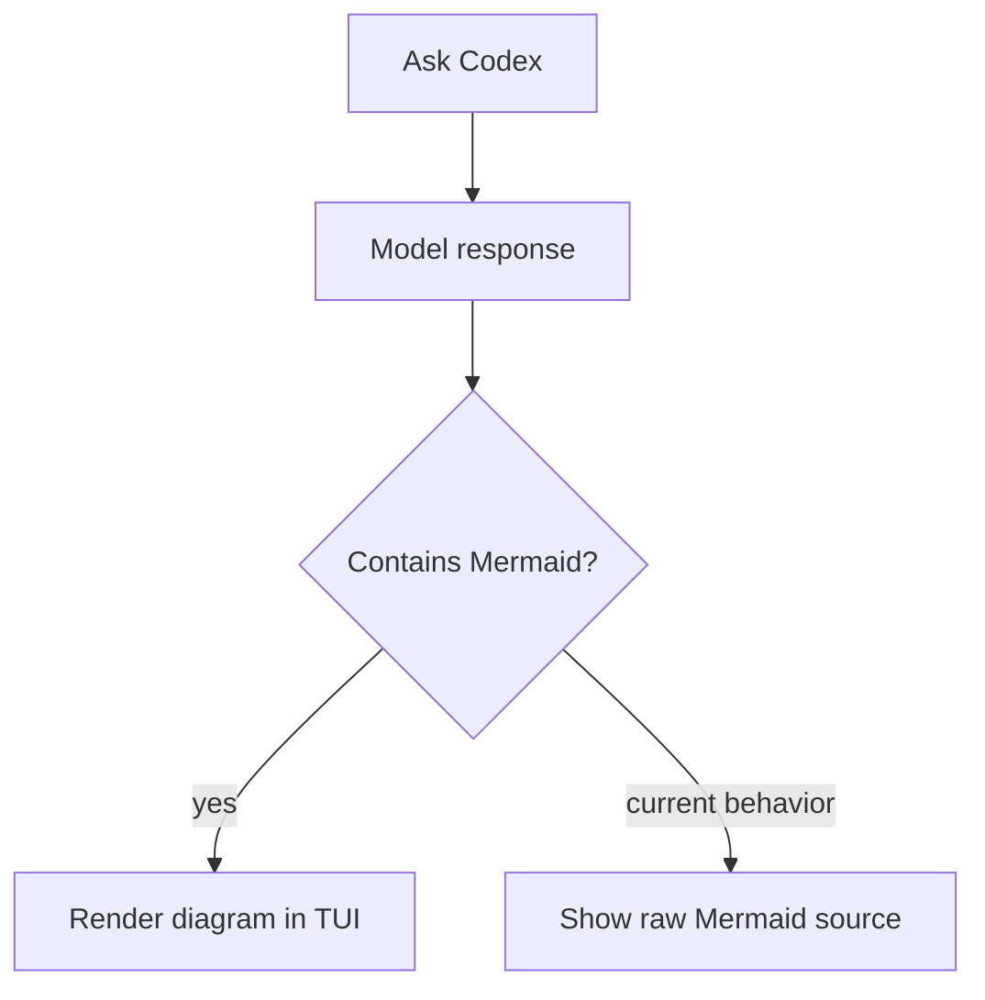

# 主源摘录

抓取 2026-09-16 · 单元格论断回链 **S#**

---

## S1 — openai/codex#35628

**文件触点：** GitHub issue 正文 · 标签 `CLI`,`TUI`

样例（F1,F3–F5,F10）：

| 核对项 | 结果 | 出处 |
|--------|------|------|
| 无 classDef | ✅ | S1 |
| 当前仅源码 | ✅ plain source text | S1 |
| 禁 mmdc | ✅ Suggested constraints | S1 → 边界见 falsification-boundary-notes |

Related：**S20** #35100 persistent canvas

---

## S2 — openai/codex#32356

样例：`flowchart LR` + A/B/C 节点 — **S2**

建议（位图模型）：**Mermaid source for editing/version control, SVG or PNG for reliable mobile viewing** — **S2 事实（issue 建议）**

---

## S5 — App Server 博客

**触点：** openai.com/index/unlocking-the-codex-harness/

组件名（F6 推断对齐）：stdio reader · message processor · thread manager · core threads — **S5**

**无** Mermaid 源文件链接 — **S19** 辅证

---

## S10 — claude-code#14375

**触点：** OP Problem Statement

> outputs … **ASCII diagrams** … misaligned — **S10 事实**

评论 tactician200 → **S21** #20529 `NOT_PLANNED` — **边界**

---

## S7 — theming 数字摘录

| 变量 | 默认值 | 出处 |
|------|--------|------|
| fontFamily | trebuchet ms, verdana, arial | S7 |
| fontSize | 16px | S7 |
| primaryColor | #fff4dd | S7 |
