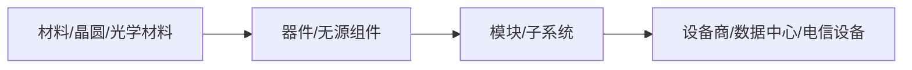

# 「高意公司」公开信息调研 — 详尽报告（收紧版）

**Asia/Shanghai 2026-09-19 14:35**（结构修订：同日追加提示词大师约束）  
**仓：** [Research_everything](https://cursor.com/codebase/melon5253/Research_everything) · **目录：** `company-gaoyi-overview-20260919-1435/`

**标注：** **事实** / **推断** / **待核实** · 关键断言绑 [sources.md](./sources.md)（S*）或 [evidence/](./evidence/)（E*）

---

## 结论（必须先答）

| 项 | 内容 |
|----|------|
| **是否唯一锁定** | **未能**将中文「高意」唯一锁定为 **单一法人**；本题（光通信/光电「高意」）命中 **两个层级**，须分表叙述、禁止混写为一家公司：**① Coherent Corp.**（上市主体，中文品牌 Coherent 高意）；**② 福州高意通讯有限公司**（境内制造法人，91350100611700460W）。统称「福州高意集团」= **多法人合称**，非工商登记名称（S5,S6,S9,E3）。 |
| **一句话业务画像** | 美国 **Coherent Corp.** 及其中福州子公司群，公开从事 **光电子/光通信器件与模块、光学与化合物半导体材料、工业与通信激光** 等 **B2B 研发制造**，处于产业链 **材料—器件/模块—子系统** 段，不经营电信运营或云业务本身（S2,S5,S9）。 |
| **最大信息缺口** | ① 境内各法人 **对外股东/境外母公司** 在 **Coherent 10-K 子公司清单** 与 **国家企业信用信息公示系统** 的一级对照缺失；② **福州口径营收/人数/专利** 二手冲突且无年报；③ **行政处罚/诉讼** 本包未检索 Primary 裁判文书/信用中国；④ 用户 **具体使用场景未指定**（见下表）。 |

---

## 结论摘要（≤10 行）

1. **锁定结论：** 非单一主体 → **Coherent Corp.（COHR）+ 福州高意通讯有限公司** 双锚点；光学/技术/苏州/上海法人 **关联但不并入** 通讯法人登记事实（§1,§4,E3）。
2. **同名拆分前置：** 下表 **8 行候选**；仅 A/B **命中** 本题；G **明确不命中**（服饰）；H 为 **股东名称片段** 非独立运营主体（§1）。
3. **来源纪律：** 工商/SEC/政府/官网 **优先**；百科（S3）**不得单独支撑事实**，仅作与 S19 交叉时的 **待核实线索**（§2,E4）。
4. **禁编造：** 本报告 **不写** 境内法人营收/估值/精确员工总数/客户名单；集团 **28,000+ 员工** 仅指 **2022 并购新闻全球口径**（S5），**不** 等同于福州人数。
5. **登记事实（通讯法人）：** 1999-09-21 设立、外资独资、晋安区福兴大道 39 号、经营范围含光通信设备制造 — **事实**（S19；曾用名见 **待核实** §4）。
6. **上市与并购：** Finisar 2019-09-24 完成收购（S4）；Coherent, Inc. 2022-07-01 完成收购并更名 Coherent（S5,S6）— **事实**。
7. **福州职能（政府稿）：** 2024-08-08 中国销售总部启动；通讯/光学/技术 **三分工**（S9）— **事实**（销售中心 **唯一性** 为引述表述，**待核实**）。
8. **产业链（推断）：** 上游材料 + 中游模块/器件，下游客户类型 **未披露名单**（S2,S10）。
9. **风险公开记录：** 本包 **未知/未核实** 针对上述法人的处罚与诉讼（§4.8）。
10. **场景相关性：** **未指定** — 仅提供光电/光通信主体辨析与公开信息汇总（§4.9）。

---

## 一页纸速览

> 独立文件：[onepager.md](./onepager.md)

---

## 1. 同名主体拆分（强制开篇）

**规则：** 在唯一锁定前，只作对照；**完整画像仅作用于「命中本题」且有多源 Primary/准 Primary 的行。**

| # | 中文名 / 英文名 / 曾用名 | 统一社会信用代码或注册地 | 行业 | 官网 / 工商源 | 命中本题？ |
|---|--------------------------|-------------------------|------|---------------|------------|
| A | **Coherent Corp.** / Coherent 高意；曾用上市名 **II-VI Incorporated** | 美国；总部 Saxonburg, PA（S2） | 材料、网络、激光；工业/通信/电子/仪器 | https://www.coherent.com/zh ；SEC S4,S5 | **是**（品牌与上市主体） |
| B | **福州高意通讯有限公司** / Fuzhou Gaoyi Communication Co., Ltd.；曾用名 **福州康顺光通讯有限公司**（**待核实** S3） | **91350100611700460W**；福州晋安区福兴大道 39 号 | 光电子/光通信设备制造 | 工商聚合 S19；百科 S3（降权）；Coherent 福州页 S20 | **是**（境内制造主法人） |
| C | **福州高意光学有限公司** / Fuzhou Photop Optics Co., Ltd.；曾用名福州晶阵半导体有限公司（S11） | **913501007380391711**；福新东路 253 号 | 光学玻璃、光电子器件 | 招聘 S11；股东摘录 E2 | **部分**（关联制造，非「高意公司」默认所指） |
| D | **福州高意技术有限公司** | 代码 **待核实**（政府稿地址：软件园晋安分园 S9）；2023-12 设立 S12 | 销售/技术服务 | 政府 S9；行业媒体 S12 | **部分**（中国区销售职能载体） |
| E | **苏州高意激光科技有限公司** | **91320594MA1XU05G5G**；苏州工业园区 | 激光加工设备、光电 | 展会稿 S15 | **部分**（同集团不同法人） |
| F | **上海高意激光技术有限公司** | **9131000060737499XC**；上海 | 激光装置、光电仪器 | 工商二手 S16 | **部分**（历史/并行法人） |
| G | **上海高意服饰辅料有限公司** | **9131010756012241XD**；上海普陀 | 服饰辅料 | 职友集 S17 | **否** |
| H | **高意科技股份有限公司**（股东登记名） | 无独立境内统一代码（股东表 E2） | — | E2 | **否**（非运营主体名称） |

**选定叙述策略：** A 与 B **分列** §4 冻结维表；C–F 仅 §7 关联摘要；**不** 将 C/D/E/F 的产能、人数、收入写入 B 的单元格。

---

## 2. 来源优先级（写死）

| 优先级 | 类型 | 本包用法 |
|--------|------|----------|
| 1 | 工商 **官方登记**、**年报/10-K/8-K** | S4,S5；境内登记 **理想源=公示系统**（本包以 S19 聚合 **降权替代**，冲突标待核实 E1） |
| 2 | **公司官网**、**监管披露** | S1,S2,S5,S6,S20 |
| 3 | **政府官网**、**权威媒体可核对稿** | S8,S9；S7 GlobeNewswire（公司发布） |
| 4 | **招聘站、第三方数据库** | S11,S19,S16 — 仅补充字段，**不单独** 证明并购/股权 |
| 禁止作事实 | **自媒体、百科无出处段落** | S3 专利数/参保/荣誉 **不采为事实**；S14 收入 **待核实**；S13 产能规划 **待核实** |

详见 [evidence/E4-source-priority-rules.md](./evidence/E4-source-priority-rules.md)。

---

## 3. 范围 In / Out

| In | Out |
|----|-----|
| 「高意」相关 **主体辨析** 与 **公开信息汇总** | 内幕、非公开尽调手段 |
| 登记、监管披露、政府稿、官网产品与市场 **描述** | 诽谤性推断、投资建议口吻 |
| 标注 **未知/未核实** 的缺口 | 把不确定主体 **写成定论**；编造营收/估值/人数/客户/股权比例 |

---

## 4. 冻结信息维（选定主体后）

### 4.1 Coherent Corp.（Coherent 高意）— 命中本题

| 维度 | 内容 | 出处 | 标注 |
|------|------|------|------|
| 基本登记 | 纳斯达克 **COHR**；总部 Saxonburg, PA；业务遍及 20+ 国家 | S2,S5 | 事实 |
| 股权/实控（公开） | 上市公司；**公开披露** 并购 Finisar、Coherent, Inc.；**不** 在本包展开股东穿透 | S4,S5 | 事实 |
| 主营与产品 | 工业、通信、电子、仪器；材料—网络—激光三 segment（并购新闻段述） | S2,S5 | 事实 |
| 融资/上市 | **已上市** COHR；2022 年完成 Coherent 收购 | S5 | 事实 |
| 关键人员（公开） | 并购新闻引述 Vincent D. Mattera Jr. 等 **高管职务** | S5 | 事实 |
| 业务与行业位置 | 全球材料/网络/激光供应商；**无** 本包引用的市占率 | S2,S10 | 事实+**不写份额** |
| 风险/诉讼/处罚 | **未知/未核实**（未检索 EDGAR 诉讼专项索引） | — | 待核实 |
| 与用户场景相关性 | **未指定** | — | — |
| 出处 | S1,S2,S4,S5,S6 | | |

### 4.2 福州高意通讯有限公司 — 命中本题

| 维度 | 内容 | 出处 | 标注 |
|------|------|------|------|
| 基本登记 | 1999-09-21；类型：外国法人独资；地址：晋安区福兴大道 39 号；代码 **91350100611700460W** | S19 | 事实（聚合源） |
| 曾用名 | 福州康顺光通讯有限公司 | S3 | **待核实**（仅百科，缺公示系统截图） |
| 注册资本 | **2,350 万美元**（S19） vs **850 万美元**（S18） | S19,S18,E1 | **冲突待核实** |
| 股权/实控（公开） | 外国法人独资；**境外股东名称本包未获 Primary** | S19 | 事实+缺口 |
| 主营与产品 | 经营范围：光电子器件、**光通信设备** 制造销售等（摘录） | S19 | 事实 |
| 融资/上市 | **非上市** 境内子公司 | S19 | 推断 |
| 关键人员（公开） | 法定代表人 **Gary A. Kapusta**（登记源拼写） | S19,S11 | 事实 |
| 业务与行业位置 | 光通信/光电子 **制造**；客户在公开源中 **未披露名单** | S19,S9 | 事实+未知 |
| 人数 | **未知/未核实**（百科/第三方参保数 **不采用**，见 E4） | — | — |
| 营收/估值 | **未知/未核实** | — | — |
| 风险/诉讼/处罚 | **未知/未核实** | — | — |
| 与用户场景相关性 | **未指定** | — | — |
| 出处 | S19,S9,S8 | | |

### 4.3 两主体关系（公开可核部分）

- **事实（S5,S6）：** II-VI（后更名 Coherent）为上市主体；中文 **Coherent 高意** 与 **II-VI 高意** 为品牌沿革。
- **事实（S9）：** 政府稿将「高意集团」在福州业务分为通讯、光学、技术三块 — **集团叙事**，不等于 B 一家公司的登记范围。
- **推断：** B 为 Coherent 在华 **光通信制造法人之一**；**精确控股链** 待 10-K 子公司表 + 公示系统（§结论 最大缺口）。

---

## 5. 沿革（分主体，不混写）

### 5.1 集团

| 日期 | 事件 | 出处 |
|------|------|------|
| 2019-09-24 | II-VI 完成收购 Finisar | S4 |
| 2018-11-05 | 福州亚太总部/5G 扩产仪式（地方） | S8 |
| 2018-10-31 | II-VI 宣布福州亚太总部与扩产（公司新闻） | S7 |
| 2022-07-01 | 完成收购 Coherent, Inc.；合并命名 Coherent | S5 |
| 2022-09-08 | 中文博客：Coherent 高意品牌说明 | S6 |
| 2024-08-08 | 高意中国销售总部启动（福州） | S9 |

### 5.2 福州高意通讯有限公司

- **事实（S19）：** 1999-09-21 设立；营业期限至 2049-09-20（聚合页展示）。
- **待核实：** 2017 法人变更、扩产环评等 **百科叙事**（S3）— 未附政府/环评 Primary。

---

## 6. 业务与产品（分主体）

### 6.1 Coherent Corp.

- **事实（S2,S10）：** 通信、数据中心、工业激光、电子 sensing、仪器等 **产品组合描述**（官网）。
- **事实（S5）：** Networking / Materials / Lasers **报告分部**（并购完成新闻）。

### 6.2 福州高意通讯有限公司

- **事实（S19）：** 登记经营范围以 **制造与销售** 光电子、光通信设备为主。
- **事实（S9）：** 政府分工称 **「高意通讯生产通信产品」** — 引述 **集团内角色**，**不** 等同于经营范围的法律文本。

### 6.3 产业链（推断，无份额）

**推断（S2,S10）：** A/B 所在生态位于 **M—MOD**；下游 OEM 名称 **未公开**。

---

## 7. 关联 / 同名主体（非 B 的冻结表）

| 主体 | 仅列公开要点 | 出处 |
|------|--------------|------|
| 福州高意光学 | 2002 设立；913501007380391711；股东名「高意科技股份有限公司」100% | S11,E2 |
| 福州高意技术 | 2023-12 设立；销售总部载体；**营收预测引述待核实** | S9,S12 |
| 苏州高意激光 | 2019 设立；91320594MA1XU05G5G；激光加工 | S15 |
| 上海高意激光 | 1997 设立；9131000060737499XC | S16 |
| 上海高意服饰 | **非本题** | S17 |

---

## 8. 市场与竞争

| 命题 | 处理 | 出处 |
|------|------|------|
| 「全球最大光通信元器件制造商」 | **待核实**，不采为事实 | S9 |
| 2019 年「销售收入 25 亿」 | **待核实**，口径不明 | S14 |
| SiC 10 万片/50 万片规划 | **待核实** | S13 |
| 垂直整合（硅光、VCSEL 等） | 官网 **营销表述** | S10 |

---

## 9. 证伪 / 边界 / 待核实清单

见 [evidence/E3-falsify-boundary-mixups.md](./evidence/E3-falsify-boundary-mixups.md)、[E1](./evidence/E1-fuzhou-comm-registration-excerpt.md)、[E4](./evidence/E4-source-priority-rules.md)。

---

## 10. 决策问题（原任务，收紧答复）

### Q1. 主对象是谁？

- **未能唯一锁定为单一法人。**
- **本题命中：** **Coherent Corp.** + **福州高意通讯有限公司**；集团统称、光学/技术等 **另表**（§1,§4）。

### Q2. 核心业务与产业链？

- **Coherent：** 材料、网络（含光通信）、激光（S2,S5）。
- **福州高意通讯：** 登记范围上的 **光电子/光通信设备制造**（S19）；产业链 **器件/模块段**（§6.3，**推断**）。

### Q3. 可核对 vs 待核实？

| 可核对 | 待核实/未知 |
|--------|-------------|
| COHR 上市；并购 Finisar/Coherent 日期 | 境内法人 **营收、人数、专利总数** |
| 通讯法人代码、地址、设立日、外资独资、经营范围（S19） | 注册资本 **850 vs 2350 万**；曾用名 |
| 2018/2024 福州仪式与政府分工（S8,S9） | 市占率、客户名单、处罚诉讼 |

---

## 11. 出处列表

详见 [sources.md](./sources.md)。证据见 [evidence/](./evidence/)。
