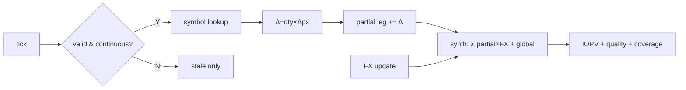

# FPGA IOPV 分市场计算与跨市场合成 — 详尽调研报告（收紧版）

**Asia/Shanghai 2026-09-16 08:42** · 修订：提示词大师口径收紧 · 上游已具备硬件行情解析

---

## 结论摘要（≤10 行）

1. **先钉口径：** 官方对齐默认 **last 成交价** IOPV；**分市场 partial** = 该 leg 内 **可加贡献项之和**（`Σ qty×px` + **本 leg 本地现金/必须替代金额**）；**跨市场合成** = **只读** 各 leg partial → FX 折算 → 加 **跨 leg 全局项**（预估现金差额、费用池）→ ÷creation unit — **禁止**在合成阶段回头重算成分 `qty×px`。
2. **默认拓扑：** Type B — **per-leg 增量累加器**（非影子全量快照）+ **单时钟域中心合成器**（leg≤4）；跨 FPGA/跨地域 leg 才上 **CDC 异步汇合**。
3. **新 tick → partial：** `Δ=qty×(px_new−px_old)` → `partial[leg]+=Δ`；`valid=0` 或集合竞价/熔断态 **不更新 px、不改动 partial**（ffill + stale）。
4. **全市场未齐：** **仍输出 IOPV**（官方惯例 ffill 各 leg）；附带 **coverage / quality**（如 `DEGRADED`、leg 覆盖率）；**不**因一侧未开盘而 withhold（除非产品显式配置 gate）。
5. **权重热更：** 官方 PCF **日更**；若自定义盘中热更 → **必须双缓冲 shadow swap + 1–2 拍 tick pause + 从 Host 下发 leg 级 partial 基线重播种**（不可 in-place 改 qty）。
6. **FX 跳变：** **不重扫成分**；仅重算 `nav_raw=Σ(partial[leg]×FX_new[leg])+global_cash` — **O(legs)**；partial 寄存器不变。
7. **停牌默认：** **last valid（前收/最后成交）ffill** + stale bit；**不用** 0 价；剔权/除息 **不在 FPGA 热路径**（Host 日更 qty/px 基线或 adjustment factor 入表）。
8. **数值：** 贡献与 partial **64b 定点**（scale 与最小价位单位对齐）；IOPV 输出 **四舍五入 4 位小数**（SSE 公告）；bid/ask IOPV 为 **并行第二/三路累加器**（可选，非官方默认）。
9. **触发：** 片内 **逐笔事件驱动** 维护 nav；对外 **15s 或 |ΔIOPV| 阈值 gate**（与计算解耦）；权重变更 **仅 shadow swap 时触发全 leg 重播种**。
10. **换方案：** **权重频繁热更**（>1×/日）→ Host 主算 + FPGA 辅助或影子快照；**跨市时段错位严重**（>4h 闭市 leg）→ leg 级 stale + 可选 FV proxy（Host 写 px_override）或 withhold 输出。

---

## 一页纸速览

> 独立文件：[onepager.md](./onepager.md)

| 冻结维 | 默认 |
|--------|------|
| 触发 | 逐笔 Δ；对外 15s/阈值；权重变更→shadow swap |
| partial 结构 | **累加器**（每 leg 一寄存器） |
| 汇合点 | **同钟** 中心合成；跨卡才 CDC |
| 表承载 | symbol 反向 BRAM + basket 正向行 |
| 停牌/熔断/集合竞价 | ffill；valid=0 不更新 partial |
| FX/现金替代 | 必须替代→leg 本地 cash；FX 在合成点乘 |
| 数值 | 64b 定点；IOPV 输出 round 4dp |
| 未齐输出 | **输出** + coverage/degraded |

---

## 1. 范围（In / Out）

### In

- **分市场计算数据路径：** tick → symbol 索引 → 增量更新 **leg partial**（含本 leg 本地现金/替代项）
- **跨市场合成数据路径：** 读 partial[] → FX → 加 global 项 → 归一 → IOPV 输出
- **控制规则：** 双缓冲表 swap、stale/coverage 标记、合成 gate、版本 tag（pcf_version / fx_version）
- **静态表承载与索引：** PCF/IOPV 清单字段、替代标志入表
- **与上游接口：** 已解析 `(px, px_type, symbol_id, market_id, ts, valid, session_state)`

### Out

- 行情协议解析 / TCP / feed handler 重做
- 策略、报单、套利检测
- 完整 RTL top/core 模块规格
- ETF **申赎业务状态机**（仅点到：**替代标志（must/may/forbid cash）写入表项** 为止）
- 未核实绝对延迟 **ns**
- 完整合规口径长文、基金管理会计报表

---

## 2. 假设与待核实（必须先读）

| 参数 | 工作假定 | 标注 |
|------|----------|------|
| **涉及市场** | 主场景 **沪 SSE + 深 SZSE**；扩展 **港 HKEX** 1 leg；美/欧 **待核实** | 待核实 |
| **上游已解析字段** | `symbol_id, market_id, px, px_type∈{last,bid,ask,mid}, ts, valid, session_state∈{continuous,auction,halt,circuit}` | 推断（接口契约） |
| **未解析/Out** | 原始 FIX/SBE 字节、订单簿深度、逐笔委托队列 | 事实（用户前提） |
| **权重/qty 更新频率** | **1×/日** 开盘前 PCF/IOPV 清单；盘中 **不变**（官方） | 事实 |
| **自定义盘中热更** | 若业务要求 → 本节给双缓冲规则；**非官方默认** | 待核实 |
| **汇率源** | 港股通：管理人/指数机构 **估值汇率**（公告口径）；刷新 **待核实**（秒级~分钟级） | 事实+待核实 |
| **纯 A 股跨市场** | **无 FX**；SSE/SZSE 两 leg 同 CNY | 推断 |
| **停牌缺价** | 默认 **last valid ffill**（含前收语义）；**剔权/除息** 由 Host 日更 adjustment， FPGA **不自动除权** | 推断+待核实 |
| **集合竞价/熔断** | `session_state≠continuous` 时 **冻结 px 更新**（同停牌） | 推断 |
| **输出置信度/覆盖率** | 默认 **输出** `quality` + `coverage_pct`（有效成分数/总成分数，按 leg 可聚合） | 推断（建议） |
| **单 ETF 成分 M** | 50–300，宽基上限 ~500 | 推断 |
| **并行 ETF 数 B** | 4–16 | 待核实 |
| **应计利息与费用** | 官方 IOPV：**预估现金差额** 已含 accrued 净效应；**不单独拆** 应计项除非清单字段要求 | 事实+推断 |
| **延迟** | 相对 Host 全量重算更低；**不写死 ns** | 范围 |

---

## 3. 术语与口径（先钉口径，再比方案）

### 3.1 IOPV vs NAV

| 术语 | 含义 |
|------|------|
| **NAV** | 日终基金份额净值，**1×/日** |
| **IOPV / iNAV** | 盘中指示性净值，基于 **calculation basket / IOPV 清单** + 盘中价 |
| **Creation unit** | 最小申购赎回单位份额 = 归一除数 |

### 3.2 IOPV 公式变体（钉死后再选型）

**基准公式（沪深，事实）：**

```text
IOPV = ( 必须现金替代固定金额
       + Σ 可现金替代成分 (qty × 最新成交价)
       + Σ 禁止现金替代成分 (qty × 最新成交价)
       + 预估现金差额 ) / 最小申购赎回单位份额
```

| 变体轴 | 选项 | 官方默认 | 硬件实现 |
|--------|------|----------|----------|
| **价格档** | last / mid / bid / ask | **last（最新成交价）** | 每档独立 `partial_*` 累加器；默认只启 last |
| **mid** | (bid+ask)/2 | **非官方 IOPV** | 需上游给 bid/ask；第二路 nav_mid |
| **bid/ask IOPV** | 成分用 best bid 或 ask | **非交易所披露默认** | Exegy 专利 Claims 11–12 支持并行 NAV 类型 |
| **应计利息** | 债券/货币类 | 通常 **并入预估现金差额** | 日更 `estimated_cash` 字段，**不进 tick 路径** |
| **费用** | 管理费/托管费 accrual | **并入预估现金差额或日更 cash 池** | Host 日更；合成只 **加总** |
| **负债** | 杠杆/借贷 | 部分 iNAV 公式显式减 liabilities | 日更 `liabilities` 字段入 global 项 |
| **舍入** |  per-share 小数位 | SSE：**四舍五入 4 位** | 输出级 round；中间 **全精度定点** |

**Deutsche Börse iNAV 公式（事实）：** `iNAV_t = (Cash + Σ p_it q_it fxt c_it) / shares` — 含 **FX 转换因子 fxt** 与 **adjustment cit**；adjustment 由 Host 日更入表，**不在 tick 路径重算**。

### 3.3 分市场 partial — 可加贡献项（硬定义）

对 leg `L`（如 SSE、SZSE、HKEX）：

```text
partial[L] = Σ_{i ∈ components(L)} ( qty_i × px_i )     // 增量维护
           + cash_substitute_local[L]                  // 必须现金替代，归属该 leg 的部分
           + cash_accrual_local[L]                     // 可选：归属该 leg 的日更 accrual 池
```

**性质：**

- partial 是 **可加标量**（同币种 **本 leg 货币**；HK leg 为 HKD 整数单位）
- **禁止**把 FX 乘进 partial[L]（FX 只在 **跨市场合成** 发生）
- **禁止**在合成阶段对成分做 `qty×px` — 合成 **只读** partial 寄存器

**与旧稿差异（收紧）：** 旧稿 partial 不含本地 cash；现定义 **必须替代金额按 leg 归属** 写入 `partial[L]` 的常数项（日更时加入，tick 不碰）。

### 3.4 跨市场合成 — 仅汇合（硬定义）

```text
nav_raw = Σ_L ( partial[L] × FX(L → report_ccy) ) + global_estimated_cash + global_fees
IOPV    = round_4dp( nav_raw × inv_divisor )
```

**合成器允许的操作：** 读 partial[]、读 FX[]、加法、乘法、读 global 常数、归一、打 quality/coverage 标记。

**合成器禁止的操作：** symbol 表 lookup、qty×px 重算、回头扫描成分列表。

**跨 leg 规则（汇合层）：**

| 规则 | 处理 |
|------|------|
| 跨币种 | `× FX(L→CNY)` |
| 跨时区 stale | **不剔除** partial；打 `stale_mask[L]` → 降 quality |
| 一侧未开盘 | ffill partial[L]；**仍输出**（Fidelity 事实：用 last/stale） |
| 全局预估现金 | **仅合成层加一次**（避免 leg 重复计） |

---

## 4. 方案分类与数据流

### 4.1 架构谱系

| 类型 | partial → 合成 | 何时用 |
|------|----------------|--------|
| **A 单 leg** | 单 partial → 直接 ÷d | 纯单市场 ETF |
| **B 多 leg 累加器 + 同钟合成（默认）** | `partial[L]` 增量 → 中心 synth | SSE+SZSE、+HK，≤4 leg |
| **C 影子快照** | 每 tick/定时拷贝全 leg 向量 → synth | 审计/回放、热更频繁 |
| **D CDC 分域** | 每域 FPGA 维护 partial → **异步 FIFO** → 汇合 FPGA | 跨地域、跨卡 |

### 4.2 默认数据流（Type B）



**新 tick 更新 partial（逐步，机制强制答）：**

1. 若 `valid=0` 或 `session_state ∈ {halt,circuit,auction}` → **skip px 更新**；可置 `stale_i`；**partial 不变**
2. 若 `px_new == px_old` → skip（可选优化）
3. `Δ = qty × (px_new − px_old)`（qty 来自静态表，**不在 tick 改**）
4. `partial[leg] += Δ`；`coverage` 计数器不变（仍算有效成分）
5. **触发 synth**（同拍或下一拍）：读 **当前** partial[] 与 FX[]，**不读成分表**

---

## 5. 冻结对比维 — 综合机制表

> 每行必须覆盖：**新 tick→partial | 未齐是否输出 | 权重热更双缓冲 | FX 跳变是否整幅重算**

| 方案 | 触发方式 | partial 结构 | 汇合点 | 权重/静态表 | 停牌·熔断·集合竞价 | FX/现金替代 | 数值精度 | 新 tick→partial | 未齐输出？ | 热更双缓冲？ | FX 跳变重算？ | 出处 |
|------|----------|--------------|--------|-------------|-------------------|-------------|----------|-----------------|------------|--------------|---------------|------|
| **B0 默认** | 逐笔 Δ；出 15s gate | **累加器**/leg | **同钟** synth | BRAM 反向+DMA 日更 swap | ffill；auction/halt 不更新 px | 必须替代→leg cash 常数；FX 在 synth | 64b 定点；出 4dp round | `partial[leg]+=qty×Δpx` | **输出**+degraded | 日更 swap；热更→shadow+重播种 | **否**；仅 O(legs) synth | 本报告+Exegy |
| **B1 影子快照** | 逐笔或定时 | **影子向量**拷贝后 synth | 同钟 | 同 B0 | 同 B0 | 同 B0 | 同 B0 | 更新累加器→**拷贝**到 shadow→synth | 输出 | swap 后 **全 shadow 重拷** | 否 | 审计场景 |
| **C0 CDC 分域** | 逐笔/leg | 累加器/域 | **CDC FIFO** | 分域 BRAM | 分域 session | 域内 FX 预处理 **禁止** | 64b | 域内同 B0 | 输出；**version 对齐** | 分域 pause+swap | 否；汇合层 O(legs) | 跨卡推断 |
| **D0 Host 主算** | 定时/批 | Host float Σ | Host | DB | Host 规则 | Host | float | Host 增量 | 可 withhold | DB 事务 | Host 重算 | DolphinDB |
| **D1 热更密集** | 权重变更触发 | 累加器+**基线重播种** | 同钟 | **双缓冲+pause** | 同 B0 | 同 B0 | 64b | swap 后 **Host 下发 partial[] 基线** | 可 gate 至 swap 完 | **是，必须** | 否 | 推断 |

**四问默认答案（B0）：**

| 问题 | 答案 |
|------|------|
| 新 tick 如何更新 partial？ | `partial[leg]+=qty×(px_new−px_old)`；无效态不更新 |
| 全市场未齐时合成是否输出？ | **是**；ffill + `quality=DEGRADED` + coverage 字段 |
| 权重热更新是否双缓冲？ | 官方日更：**是**（DMA shadow swap）；盘中热更：**必须** shadow+pause+partial 重播种 |
| 汇率跳变是否整幅重算？ | **否**；partial 不变，只重跑 synth `Σ(partial×FX)` |

---

## 6. 各机制深挖

### 6.1 权重与静态表承载

| 字段 | 所在表 | 更新 |
|------|--------|------|
| `qty, leg_id, substitute_flag` | 反向 header | 日更 / shadow swap |
| `cash_substitute_local[leg]` | basket 或 leg 行 | 日更 |
| `global_estimated_cash, fees` | basket 行 | 日更 |
| `divisor, inv_divisor` | basket 行 | 日更 |
| `adjustment_factor` | 成分 header | 日更（除权除息） |
| `last_px, stale` | 成分 header | tick |

**双缓冲流程（权重变更 / 日更）：**

1. Host 写 `buf_B`（完整表 + **预计算每 leg partial 基线** `partial_seed[L]`）
2. 发 `swap_req` → 硬件 **pause tick 1–2 周期**
3. 指针 swap → `partial[L] := partial_seed[L]`（**重播种**，非 delta 修补）
4. resume tick

**推断：** 盘中若 **频繁热更**（>1×/日），delta 路径与 qty 变更 **不一致** 风险上升 → 换 **D1** 或 Host 主算。

### 6.2 停牌 · 熔断 · 集合竞价

| 状态 | px 更新 | partial | 合成 | 标注 |
|------|---------|---------|------|------|
| **continuous + valid** | 正常 | +=Δ | 正常 | — |
| **halt / circuit** | **freeze** | 不变 | 输出+stale | 推断；对齐 ffill |
| **call auction** | **freeze**（官方 IOPV 用 last） | 不变 | 输出 | 推断 |
| **valid=0** | skip | 不变 | 输出+degraded | — |
| **前收 vs 剔权** | 默认 **last valid**；除息 **Host 日更 adjustment** | — | — | **待核实** 产品 |

**禁止：** halt 时 `px=0` 导致 partial 暴跌。

### 6.3 汇率与现金替代路径

```text
必须现金替代 ──日更──► partial[L].cash_substitute_local  ──┐
可/禁替代成分 tick ──Δ──► partial[L].equity_sum          ├──► partial[L] ── synth ──► ×FX(L)
FX feed ───────────────► FX[L] 表（独立版本号）          ──┘
预估现金差额 ──日更──► global_estimated_cash（仅 synth 加一次）
```

**FX 跳变（机制强制答）：**

- 事件：`FX[L]` 更新，`fx_version++`
- 动作：**不碰** partial[]；触发 synth 用新 FX 重算 `nav_raw`
- 代价：**O(legs)** 乘法加法，**与成分数 M 无关**
- **不是**「整幅重算」：不重扫 symbol 表、不重做 qty×px

### 6.4 数值精度

| 阶段 | 格式 | 舍入 |
|------|------|------|
| qty×px、partial 累加 | **64b signed 定点**，scale = 最小价位×10⁴ **（推断）** | **不舍入** |
| FX 乘 | Q16.16 或 Q32.32 | 截断/就近 **（待核实）** |
| nav_raw | 64b | 不舍入 |
| IOPV 输出 | 定点 | **round 4dp**（SSE 事实） |
| bid/ask 路 | 独立 64b 累加器 | 同 last 路 |

**禁止写死：** 绝对 cycle/ns 延迟。

### 6.5 置信度 / 覆盖率输出（建议默认开启）

```text
coverage_pct = valid_components / total_components   // 按 basket
quality = OK | DEGRADED | STALE_LEG | PCF_SWAP
leg_mask = bitmask of stale legs
```

**事实依据：** 交易所 IOPV 仍发布，但文档披露外国成分/闭市价 **可能陈旧**（SEC Form 497、Fidelity）— 输出侧 **应显式标记** 而非 silent wrong precision。

---

## 7. 默认推荐与换方案条件

### 7.1 默认组合（B0）

| 层 | 选择 |
|----|------|
| **拓扑** | symbol 反向 BRAM → **per-leg 累加器** → **同钟中心 synth** |
| **价格** | **last** 单路；bid/ask 作可选第二路 |
| **partial 定义** | 可加贡献项含 **本 leg 本地必须替代 cash** |
| **停牌** | **last valid ffill** + stale；auction/halt **不更新 px** |
| **FX** | synth 点 `×FX`；跳变 **只 synth 不重扫** |
| **未齐** | **输出 IOPV** + degraded + coverage |
| **权重** | **日更 shadow swap**；swap 时 **partial 重播种** |
| **对外** | 片内逐笔；dissemination **15s 或阈值** |

### 7.2 何时换方案

| 条件 | 换什么 | 原因 |
|------|--------|------|
| **权重频繁热更**（>1×/日或 intraday PCF） | **D1**：shadow swap + 强制 partial 重播种；或 **D0 Host 主算** | delta 路径无法安全 in-place 改 qty |
| **跨市时段错位大**（某 leg 闭市 >4h 且需 FV） | leg stale + **Host px_override** 入表；或 **withhold + 最后有效 IOPV** | 硬件不内置 FV 模型（Franklin 2026 事实） |
| **leg >4 或跨卡** | **C0 CDC** 分域 partial → FIFO 汇合 | 同钟 fan-in 时序/布线压力 |
| **需 tick 级审计回放** | **B1 影子快照** | 累加器 alone 不便时间点取证 |
| **M>500 且多 ETF** | 热集 BRAM + 扇出链；仍 **禁止** tick 全量扫 | 资源与延迟 |
| **要对齐官方 15s IOPV 仅** | B0 计算仍逐笔；**仅输出 gate 15s** | 交易所惯例（JPX/中证网） |

---

## 8. 工作示例

### 8.1 示例 ①：单市场 tick → partial（含本地 cash 项）

**设定：** ETF `B1`，leg=SSE；creation unit=1,000,000

- 成分 `S_123`：qty=1000，last 10.00→10.06
- 其余 equity sum = 4,990,000
- `cash_substitute_local[SSE]` = 30,000（必须替代，日更已并入 partial）
- `partial[SSE]` 初始 = 5,000,000 + 30,000 = 5,030,000
- global_estimated_cash = 20,000

**tick 处理：**

```text
Δ = 1000 × 0.06 = 60
partial[SSE] = 5,030,000 + 60 = 5,030,060
nav_raw = 5,030,060 + 20,000 = 5,050,060
IOPV = round_4dp(5,050,060 / 1,000,000) = 5.0501
```

**合成未碰：** qty 表、symbol lookup（仅 tick 路径写过 partial）。

### 8.2 示例 ②：两市场 + HK stale + FX 跳变

**设定：** leg0=SSE CNY，leg1=HK HKD；report_ccy=CNY

- `partial[SSE]` = 3,000,000；`partial[HK]` = 500,000 HKD 单位
- `FX(HK→CNY)` = 0.9200 → **0.9250**（跳变）
- HK 成分停牌：`valid=0`，partial[HK] **冻结** 500,000
- global_cash = 100,000；divisor = 2,000,000

**停牌后首次 synth（FX 旧）：**

```text
nav_raw = 3,000,000 + 500,000×0.9200 + 100,000 = 3,860,000
IOPV = 1.9300；quality=DEGRADED；stale_mask=0b10
```

**FX 跳变后（partial 未动）：**

```text
nav_raw = 3,000,000 + 500,000×0.9250 + 100,000 = 3,862,500
IOPV = 1.9313；quality=DEGRADED
```

**整幅重算？** **否** — 无成分 lookup，2 次乘法+加法。

---

## 9. 风险与待核实

| 项 | 说明 |
|----|------|
| 目标 ETF 清单 | 沪/深/港/QDII 未指定 |
| FX 刷新频率与源 | 估值汇率具体 feed **待核实** |
| 剔权/除息 FPGA 边界 | 默认 Host adjustment；**待核实** |
| bid/ask IOPV 是否必须交付 | **待核实** |
| 闭市 leg 是否 withhold | 默认 **仍输出**；FV 产品 **待核实** |
| coverage 字段是否对外披露 | 建议内部；外部 **待核实** |
| 债券/货币 ETF | SZSE 可不发布 IOPV |

---

## 10. 与上游接口契约

```text
struct MdTick {
  uint32_t symbol_id;
  uint8_t  market_id;       // → leg_id
  int64_t  px;              // 定点
  uint8_t  px_type;         // LAST/BID/ASK/MID
  uint64_t ts_ns;
  uint8_t  valid;
  uint8_t  session_state;   // CONT/AUCTION/HALT/CIRCUIT
};

struct IopvOut {
  uint32_t basket_id;
  int64_t  iopv;            // per share, 4dp
  uint8_t  px_basis;        // LAST default
  uint8_t  quality;         // OK/DEGRADED/STALE_LEG/PCF_SWAP
  uint16_t coverage_pct;    // 0..10000 = 0.00%..100.00%
  uint8_t  stale_leg_mask;
  uint32_t pcf_version;
  uint32_t fx_version;
  uint64_t calc_ts;
};
```

---

## 11. 出处

详见 [sources.md](./sources.md)（≥16 条，事实/推断/待核实分标）。
