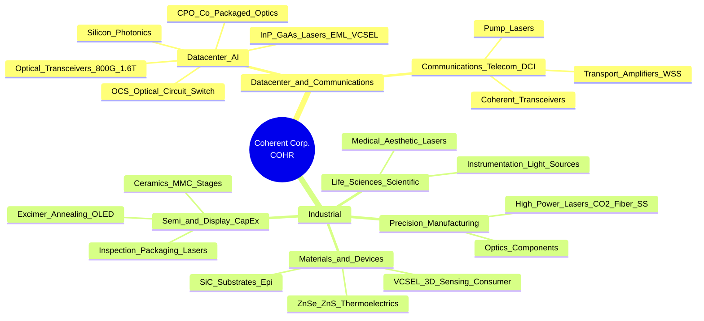

# Coherent 公司认知地图（面试用）

> 研究截止：2026-10-11｜主体：Coherent Corp.（NYSE: **COHR**）｜口径优先采用公司官网、FY2026 10-K 与 FY2026 Q4 财报。  
> **身份澄清**：本报告专指公开交易的光子学/材料公司 **Coherent Corp.**（前身 II-VI Incorporated，2022 年收购收购 Coherent, Inc. 后更名）。勿与已并入、不再独立上市的旧 **Coherent, Inc.**，或其他同名非相关企业混淆。

---

## 一句话定位

**Coherent 是一家垂直整合的全球光子学龙头**：从化合物半导体材料与器件，做到光模块、光网络与工业激光系统，核心增长引擎是 **AI 数据中心光互连**，同时保留工业激光、显示/半导体设备、仪器与工程材料等业务。

---

## 公司名片（名称/历史/规模/总部）

| 维度 | 要点 |
|------|------|
| **法定名称** | Coherent Corp.（宾夕法尼亚州注册公司） |
| **股票代码** | NYSE: **COHR**（曾用 Nasdaq: IIVI / 旧 Coherent 的 COHR） |
| **总部** | 375 Saxonburg Blvd, Saxonburg, PA 16056（匹兹堡以北） |
| **成立** | **1971** 年以 **II-VI Incorporated** 成立（名称来自元素周期表 II–VI 族化合物材料） |
| **关键并购** | **2019** Finisar（光通信/收发器与 InP 平台）；**2022-07-01** II-VI 完成收购 **Coherent, Inc.**；**2022-09-08** 公司更名为 Coherent Corp. |
| **现任管理层** | CEO **Jim Anderson**（2024-06 上任，前 Lattice Semiconductor CEO）；CFO **Sherri Luther**（2024-09）；CTO **Julie Sheridan Eng** |
| **规模（FY2026，截至 2026-06-30）** | 营收约 **$71.2 亿**（同比 +22.5%）；员工约 **51,000**；运营覆盖 **20+ 国家** |
| **板块结构（自 2025-07-01）** | 两大报告板块：**Datacenter & Communications**、**Industrial**（此前为 Networking / Materials / Lasers 三板块） |

**历史一句话**：材料与光电子（II-VI）+ 光通信规模（Finisar）+ 工业/科研激光品牌（Coherent, Inc.）→ 今天的“材料到系统”光子学平台。

---

## 业务全景图（按业务板块）

**营收结构（FY2026）**

| 板块 | 营收 | 约占比 | 同比方向 |
|------|------|--------|----------|
| Datacenter & Communications | **$52.75 亿** | ~74% | 强劲增长（AI 光模块拉动） |
| Industrial | **$18.44 亿** | ~26% | 约 **-10%**（部分因剥离航空航天/国防与慕尼黑加工设备业务） |
| **合计** | **$71.18 亿** | 100% | **+22.5%** |

**板块如何关联（面试可用）**

1. **同一套化合物半导体能力**（InP / GaAs / SiC 等）同时服务数据中心光器件与工业/消费/功率电子。  
2. **垂直整合**：晶圆/器件 → 光学组件 → 模块/子系统/系统，利于成本、供应与定制。  
3. **战略重心已明显倾斜 D&C**：AI 数据中心从铜向光互连迁移是当前叙事主轴；Industrial 做“稳定基座 + 选择性聚焦”，非核心已在剥离。

---

## 各板块：做什么、卖给谁、关键技术

### 1. Datacenter & Communications（数据中心与通信）

| 维度 | 内容 |
|------|------|
| **做什么** | 光收发模块（Transceiver）、共封装光学（CPO）、光电路交换机（OCS）、相干光模块、传输/放大/无光组件、VCSEL/EEL/泵浦激光、探测器、IC、无源光学与 PIC 等 |
| **卖给谁** | 超大规模云与 AI 数据中心运营商；网络设备商与光模块/组件客户；电信运营商与 DCI（数据中心互联）场景；协议覆盖 Ethernet、InfiniBand、NVIDIA NVLink 等 AI 组网架构 |
| **关键技术** | **InP**（下一代 AI 光互连基础材料，公司在扩 6 英寸产能）；**GaAs VCSEL**；**EML**；硅光；**CPO**；**OCS**（数字液晶技术）；相干光（带宽升级、功耗与尺寸优化）；泵浦激光（GaAs / InP Raman） |
| **近期能力建设** | 德州 Sherman InP 产能扩建；与 **NVIDIA** 多年期战略供货/合作；CHIPS Act 相关约 **$5,000 万** 意向支持 |

**面试记忆点**：公司自称在 AI 数据中心光模块上具备“协议无关、垂直整合（自产激光、探测器、IC、光学、热管理、PIC）”的组合优势；研发重点含 800G/1.6T、面向 3.2T/6.4T 的 400G/lane 组件、CPO 与 OCS。

### 2. Industrial（工业）

| 子市场 | 做什么 | 典型客户/场景 | 关键技术 |
|--------|--------|----------------|----------|
| **精密制造** | 高功率激光与光学部件 | 材料加工、EV 电池焊接、医疗器械微加工、增材制造等 | 固态激光、CO₂、高功率激光系统 |
| **半导体设备** | 材料与激光用于晶圆厂设备 | 设备 OEM：检验、退火、先进封装钻孔/切割/去粘、打标 | 准分子/固态/CO₂ 激光；金属基复合材料与反应烧结陶瓷（轻质、热稳定） |
| **显示设备** | 显示产线激光工具 | OLED LTPS 退火、切割；MicroLED 相关 UV/DUV 方案 | **Excimer** 准分子激光系统；CO₂ / 超快 UV |
| **生命科学/医疗** | 光源、热电、医疗激光 | 流式细胞、测序、PCR；医美；LASIK 等 | 可见光激光、多色激光引擎；半导体激光 bar/stack；飞秒+准分子 |
| **科研** | 连续/超快/高能脉冲激光 | 高校与研究所（神经/光遗传学等） | CW、超快、准分子气体激光 |
| **消费电子** | VCSEL 阵列、InP 边发射、特种玻璃等 | 手机/平板/ARVR、3D 传感、部分汽车应用 | 6 英寸 GaAs VCSEL 平台 |
| **汽车/无线（材料侧）** | **SiC** 衬底（含 200 mm 半绝缘） | GaN-on-SiC HEMT RF 功率器件 → 4G/5G/6G 基站等；SiC 功率电子供应链 | SiC 晶体生长与外延；与 DENSO、Mitsubishi Electric 等战略投资/合作结构 |

**注意**：Aerospace & Defense 光学/激光业务已于 **2025** 出售给 Advent（约 **$4 亿**）；慕尼黑材料加工工具业务售予 Bystronic（约 **2026 年初**交割）。面试时勿再把“国防整块业务”当当前核心。

---

## 行业与竞争格局

### 需求侧（谁在买）

- **AI / 超大规模数据中心**：光模块、激光器、CPO/OCS 等互连升级（公司称 FY2026 有 **两家客户各自贡献收入 >10%**）。  
- **云/电信设备商与运营商**：DCI、相干光、传输与放大。  
- **工业 OEM 与终端制造**：激光加工、显示与半导体资本开支相关设备。  
- **仪器与生命科学 OEM**、部分消费电子与汽车供应链。

### 竞争侧（高层面，不必背份额）

| 领域 | 常见对标/竞品类型 | Coherent 常被强调的差异 |
|------|-------------------|-------------------------|
| **光模块 / AI 光互连** | Lumentum；中国模块龙头（如 Innolight、Eoptolink 等）；部分设备商自研（Cisco Acacia 等） | 更强调 **激光+模块+材料垂直整合**、InP 自有产能与产品面宽度 |
| **激光器件（EML 等）** | Lumentum、Broadcom（原 Avago 系）、Sumitomo、Mitsubishi 等 | 器件与模块双栖；与 CPO/系统演进绑定 |
| **DSP / 交换硅 / CPO 平台** | Broadcom、Marvell 等 | 多为生态伙伴或架构层竞争者，非简单“同品类对打” |
| **工业激光** | TRUMPF、IPG、nLIGHT 等（按产品线不同） | 与材料/光学组合；显示准分子等细分强项 |
| **SiC 衬底** | Wolfspeed、中国衬底厂等 | 公司强调 **200 mm** 能力与客户绑定；业务以子公司形式引入战略股东（DENSO / Mitsubishi Electric 各约 12.5%，Coherent 约 75%） |

**面试表述建议**：竞争高度分层——模块拼规模与客户导入，器件拼工艺与稀缺产能，材料拼晶体/晶圆能力；Coherent 的故事是“跨层垂直整合 + AI 光互连主航道聚焦”。

---

## 近期战略与值得记住的事实（标注年份与来源）

| 时间 | 事实 | 为何面试有用 | 来源 |
|------|------|--------------|------|
| **2022-07** | II-VI 完成收购 Coherent, Inc.；同年 9 月更名 Coherent Corp. | 解释“为何叫 Coherent、出身是 II-VI” | [并购新闻](https://www.coherent.com/news/press-releases/ii-vi-completes-acquisition-of-coherent) |
| **2024-06** | Jim Anderson 出任 CEO | 管理层换代、运营与利润率叙事转折 | FY2026 10-K 高管披露；维基摘要 |
| **2024-09** | Sherri Luther 任 CFO | 财务纪律、非 GAAP 口径与资本配置常被问到 | 同上 |
| **2025-07-01** | 报告板块改为 **D&C + Industrial** 两板块 | 面试勿死背旧三板块；要能说新旧映射 | [FY2026 10-K](https://www.sec.gov/Archives/edgar/data/820318/000082031826000020/iivi-20260630.htm) |
| **2025-05** | Analyst Day：强调 AI 数据中心、双位数增长与利润率扩张 | 战略口径官方版 | [Analyst Day 相关报道](https://www.marketscreener.com/quote/stock/COHERENT-CORP-9656/news/Coherent-Details-Growth-Strategy-and-Long-Term-Financial-Model-at-2025-Analyst-and-Investor-Day-50092202/) |
| **2025-08 / 2025-09** | 以约 **$4 亿** 向 Advent 出售航空航天与国防业务（约 550 人、10 个站点）；用于降债 | “聚焦核心、去非核心”的证据 | [A&D 出售新闻](https://www.coherent.com/news/press-releases/coherent-announces-agreement-to-sell-aerospace-and-defense-business-to-advent) |
| **2025-10 / 2026-01** | 材料加工工具产品线售予 Bystronic；FY2026 确认 Munich 业务剥离 | Industrial 收入下滑的合理解释 | [Bystronic 交易新闻](https://www.coherent.com/news/press-releases/coherent-announces-agreement-to-sell-mMaterials-processing-tools-product-division-to-bystronic)；FY2026 财报 |
| **2026-03** | 与 **NVIDIA** 多年期非独占战略协议：数十亿美元采购承诺 + NVIDIA **$20 亿** 投资支持美产能与研发 | 最高频“为什么这家公司火”谈资 | [NVIDIA 合作新闻](https://www.coherent.com/news/press-releases/nvidia-and-coherent-announce-strategic-partnership) |
| **2026** | Sherman, TX InP 扩建；CHIPS Act 约 **$5,000 万** 初步条款意向 | 产能与地缘供应链叙事 | 10-K；[CHIPS 相关新闻](https://www.coherent.com/news/press-releases/a-chip-letter-of-intent-for-50m-to-expand-world-leading-manufacturing-facility-for-ai-infrastructure) |
| **FY2026（至 2026-06-30）** | 营收 **$71.2 亿**；D&C **$52.8 亿**；GAAP 稀释 EPS **$4.12**；Q1 FY2027 指引营收约 **$22–24 亿** | 用数字证明“AI 光互连驱动增长” | [FY2026 Q4 财报 PDF](https://www.coherent.com/content/dam/coherent/site/en/documents/investors/financial-releases/2026/august-12/earnings-release-fy26-q4.pdf) |
| **CEO 叙事（2026-08）** | AI 数据中心从 **铜互连转向光互连** 的多年周期；扩产与新产品平台爬坡 | 面试“行业趋势”标准答案 | 同上财报 |

**战略一句话（可背）**：在 Anderson 治下，Coherent 正在 **收缩非核心工业/国防资产、加码 AI 光子学产能与技术路线（模块→CPO/OCS）、同时用 SiC 等材料平台做长期期权**。

---

## 面试高频术语表

| 术语 | 白话解释 |
|------|----------|
| **Photonics（光子学）** | 用光（光子）做传感、通信、加工与计算互连的技术总称 |
| **Vertical integration（垂直整合）** | 自己做材料/器件/光学/模块乃至系统，减少对外依赖 |
| **Optical transceiver（光模块/光收发器）** | 电↔光转换的可插拔模块，数据中心交换机到服务器的“网线升级版” |
| **800G / 1.6T / 3.2T** | 模块总带宽代际；数字越大，单端口吞吐越高 |
| **EML** | 电吸收调制激光器，高速率直连光常用光源 |
| **VCSEL** | 垂直腔面发射激光器，3D 传感与短距光互连常见 |
| **EEL** | 边发射激光器 |
| **InP / GaAs** | 铟磷/砷化镓化合物半导体，光通信激光与探测器核心材料 |
| **SiC** | 碳化硅，功率电子与部分 RF（GaN-on-SiC）衬底 |
| **Silicon photonics（硅光）** | 在硅上做光波导/调制等，利于与电子集成 |
| **CPO（Co-Packaged Optics）** | 光引擎与交换机 ASIC 共封装，降低功耗与互连瓶颈 |
| **OCS（Optical Circuit Switch）** | 光电路交换机，用光域切换改善 AI 集群互连拓扑 |
| **DCI** | 数据中心之间的光互联（Datacenter Interconnect） |
| **Coherent optics（相干光）** | 用相位等信息调制解调，适合更长距离、更高谱效（注意：与公司名同词不同义） |
| **PIC** | 光子集成电路 |
| **DSP** | 数字信号处理器，相干光与高速链路关键芯片（常外购） |
| **Excimer laser（准分子激光）** | 紫外气体激光，显示退火、半导体与医疗等 |
| **CO₂ laser** | 二氧化碳激光，切割/焊接/工业加工常见 |
| **LTPS / OLED annealing** | 低温多晶硅工艺相关激光退火，用于高端显示 |
| **Pump laser（泵浦激光）** | 给光纤放大器等“供能”的激光器 |
| **WSS** | 波长选择开关，光传输网络可重构关键器件 |
| **OEM** | 设备/系统厂商客户，把 Coherent 部件装进自己的产品 |
| **Hyperscaler** | 超大规模云厂商（AWS、微软、谷歌、Meta 等类型客户） |
| **CHIPS Act** | 美国芯片法案激励，支持本土半导体制造扩建 |
| **Non-GAAP** | 剔除股权激励、并购摊销、重组等后的业绩口径（财报常并列披露） |

---

## 面试可讲的 10 个要点

1. **定位清晰**：不是“纯激光公司”也不是“纯模块代工厂”，而是 **材料→器件→模块/系统** 的光子学平台；今日增长极是 **AI 数据中心光互连**。  
2. **历史叙事**：II-VI（材料）+ Finisar（光通信）+ Coherent, Inc.（激光系统）→ 2022 品牌统一为 Coherent Corp.；能说清并购顺序即显专业。  
3. **板块会讲**：现用 **D&C vs Industrial**；旧三板块（Networking / Materials / Lasers）知道映射即可，避免背过时组织。  
4. **数字锚点**：FY2026 营收约 **$71 亿**，D&C 约占 **3/4**；员工约 **5.1 万**；总部 **Saxonburg, PA**。  
5. **行业趋势**：AI 集群规模↑ → 交换机/服务器互连带宽与功耗压力↑ → **可插拔高速模块 + CPO/OCS** 长期渗透；CEO 公开强调 **铜→光**。  
6. **技术护城河表述**：InP/GaAs 自有制造、宽产品栈、全球制造分散带来的供应链韧性（公司 10-K 自述卖点）。  
7. **客户集中风险意识**：FY2026 **两家客户各 >10% 收入**——谈增长时主动提“大客户依赖与议价权”，显成熟。  
8. **战略动作**：卖 A&D（Advent）、卖慕尼黑加工工具（Bystronic）= 聚焦；NVIDIA 多年期合作 + Sherman 扩产 = 押注 AI 光子学。  
9. **SiC 单独讲一层**：不是当前营收主角，但是 **功率电子/EV/无线基础设施** 的长期材料期权，且有战略股东绑定。  
10. **为什么加入/为什么这个岗**：可结合岗位说——工程岗强调 InP/模块/激光工艺与量产爬坡；业务岗强调 AI CapEx 周期、竞争分层、垂直整合价值主张。

**可选加分句**：区分公司名 “Coherent” 与技术术语 “coherent optics（相干光通信）”，避免面试官追问时卡壳。

---

## 信息来源列表（URL）

### 官方与 SEC（优先）

1. Coherent 公司简介：https://www.coherent.com/company  
2. II-VI 完成收购 Coherent, Inc.（2022-07-01）：https://www.coherent.com/news/press-releases/ii-vi-completes-acquisition-of-coherent  
3. FY2026 Form 10-K（截至 2026-06-30）：https://www.sec.gov/Archives/edgar/data/820318/000082031826000020/iivi-20260630.htm  
4. FY2026 Q4 / 全年业绩新闻稿 PDF（2026-08-12）：https://www.coherent.com/content/dam/coherent/site/en/documents/investors/financial-releases/2026/august-12/earnings-release-fy26-q4.pdf  
5. 投资者关系入口：https://www.coherent.com/company/investor-relations  
6. NVIDIA–Coherent 战略合作（2026-03-02）：https://www.coherent.com/news/press-releases/nvidia-and-coherent-announce-strategic-partnership  
7. 出售航空航天与国防业务予 Advent（2025-08-13）：https://www.coherent.com/news/press-releases/coherent-announces-agreement-to-sell-aerospace-and-defense-business-to-advent  
8. 出售材料加工工具业务予 Bystronic：https://www.coherent.com/news/press-releases/coherent-announces-agreement-to-sell-mMaterials-processing-tools-product-division-to-bystronic  
9. Sherman / CHIPS 相关扩产意向：https://www.coherent.com/news/press-releases/a-chip-letter-of-intent-for-50m-to-expand-world-leading-manufacturing-facility-for-ai-infrastructure  
10. SiC 业务战略投资（DENSO / Mitsubishi Electric）：https://www.coherent.com/news/press-releases/silicon-carbide-semiconductor-business-investment  

### 次要参考

11. Wikipedia – Coherent Corp.：https://en.wikipedia.org/wiki/Coherent_Corp.  
12. 2025 Analyst Day 相关报道：https://www.marketscreener.com/quote/stock/COHERENT-CORP-9656/news/Coherent-Details-Growth-Strategy-and-Long-Term-Financial-Model-at-2025-Analyst-and-Investor-Day-50092202/  
13. EDGAR 公司页（CIK 0000820318）：https://www.sec.gov/cgi-bin/browse-edgar?CIK=COHR&action=getcompany  

---

## 附录：已知缺口 / 使用注意

- **具体大客户名称**：10-K 仅披露“两家各超 10%”，未在本报告依赖的官方文件中点名；市场传闻中的超大规模云厂商勿当已核实事实在面试断言。  
- **竞争份额数字**：第三方研报口径不一，面试宜讲 **竞争结构** 而非死背百分比。  
- **维基员工数/收入** 仍可能滞后于 FY2026；以 **10-K / 财报**（约 51,000 人、$71.2 亿）为准。  
- **旧三板块财务拆分** 在 FY2026 已重述为两板块；若面试官仍用 Networking/Materials/Lasers 提问，先对齐时间口径再答。  
- 本文件为公开信息整理的面试认知地图，**非投资建议**。
