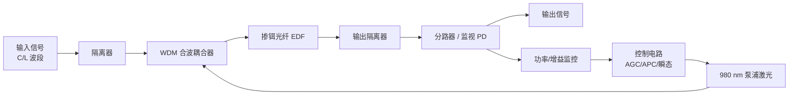

# 高意（Coherent）EDFA 产品扫盲文（面试用）

> 研究截止：2026-10-13｜主体：Coherent Corp.（NYSE: **COHR**，中文常称 **高意**）  
> 口径：优先采用公司官网 Wavelength Management / Amplifiers、Pump Lasers 页面、POLS 数据表与官方新闻稿。  
> **身份澄清**：本文讲的是光子学公司 **Coherent Corp.** 的掺铒光纤放大器业务，不是“相干光通信（coherent optics）”这一调制/检测技术本身——二者英文都叫 coherent，面试时务必分清。  
> **规格声明**：下文标注“官网宣称”的数字来自营销页/新闻稿/数据表；未找到公开出处的规格一律不编造。多数 EDFA 系列为**可定制模块**，量产 SKU 细节常需向销售索取数据表。

---

## 0. 一句话先记住

**EDFA（Erbium-Doped Fiber Amplifier，掺铒光纤放大器）** 用 980 nm（或 1480 nm）泵浦光，把 C/L 波段（约 1530–1625 nm）的多路 WDM 信号在**光域**直接放大，无需光电再生。  
**高意**在这条链路上既卖 **EDFA 模块/可插拔线路子系统（如 POLS）**，也卖驱动 EDFA 的核心器件——**自研 980 nm 泵浦激光器**（GaAs 芯片平台），并配套微光学无源混合器件；叙事上属于 **Datacenter & Communications** 里的 **Telecom Transport / Wavelength Management**，不是工业激光那条线。

---

## 1. EDFA 是什么？（物理直觉，一段话）

铒（Er³⁺）离子掺入石英光纤后，吸收约 **980 nm**（或 **1480 nm**）的泵浦光，把电子“泵”到高能级；当约 **1550 nm** 的信号光经过时，受激辐射把信号光子复制放大——这就是 EDFA。  
实用网络里最常用的是 **C 波段**（约 1530–1565 nm，DWDM 核心窗口）和 **L 波段**（约 1565–1625 nm，用于扩容）。高意官网明确提到 FlexSOM 有 **C-band** 与 **L-band 变体**；多数宣传页以 C 波段 WDM/ROADM/相干传输为主。泵浦波长多用 **980 nm**（噪声表现通常更好、高意自家泵浦产品线也以 980 nm 为主），1480 nm 泵浦在个别高功率/特定设计中也会见到（本文不展开）。

**和“相干光（coherent optics）”的区别**：相干光指用本振激光做 IQ 调制与相干接收（如 400G/800G ZR）；**EDFA 是放大器**，可以放大相干信号，也可以放大非相干/直接检测信号——它不负责“相干解调”。

---

## 2. 为什么网络需要 EDFA？

光纤有损耗（典型单模光纤约 0.2 dB/km 量级，外加连接器、合分波、ROADM 插损）。信号走几十到上千公里后会弱到接收机无法可靠判决。

早期做法是每隔一段做 **O-E-O 3R 再生**（光→电→光），贵、慢、难升级。EDFA 出现后，可以在光路上直接把整段 **DWDM 多波长一起放大**，系统因此能：

| 需求 | EDFA 提供的直觉价值 |
|------|---------------------|
| 补偿跨段损耗 | 把功率抬回可用电平（Booster / In-line / Pre-amp） |
| 多波长一起放 | 一块放大器服务整段 C/L 波段，不必每波长单独再生 |
| 改善可达距离 | 更远的跨段或更少的再生站 |
| 保护 OSNR | 增益本身会引入 ASE 噪声；好的放大器追求**低噪声系数（NF）**，避免把信噪比“吃掉” |

**OSNR 直觉（不讲公式）**：接收端要的是“信号比噪声亮多少”。EDFA 把信号放大，同时也产生 **ASE（自发辐射噪声）**。增益越大、级联站越多，ASE 越容易堆高；所以系统设计既要够增益，又要控 NF、控每站输出功率，避免非线性与噪声一起恶化。

典型角色分工（行业通用，非高意专有名词）：

- **BA（Booster Amplifier）**：发端后，抬高入纤功率  
- **ILA（In-line Amplifier）**：线路中间，补偿跨段损耗  
- **PA（Pre-Amplifier）**：收端前，抬高进接收机的功率  

高意 POLS 数据表里就明确区分了模块内的 **TX(BA)** 与 **RX(PA)**。

---

## 3. 典型结构（用文字 + mermaid）

一个简化的单级 EDFA 光路大致是：



各块在干什么：

| 部件 | 作用 |
|------|------|
| **泵浦激光（Pump）** | 提供 980 nm 能量；高意强调自研高效 980 nm（含双芯片、非制冷微泵浦） |
| **WDM 耦合器** | 把泵浦光与信号光合进同一根纤 |
| **EDF** | 真正发生受激辐射放大的掺杂光纤 |
| **隔离器（Isolator）** | 防反向 ASE/反射，保护稳定性与泵浦 |
| **分路/监视（Tap + PD）** | 测输入/输出功率，供控制环使用；高意新闻稿提到 isolator-tap photodiode 一类集成无源 |
| **增益控制** | AGC（定增益）/ APC（定输出功率）/ 自动模式；可变增益还要能**快速瞬态抑制**（通道突增突减时增益别疯） |
| **可选：可调滤波** | 固定增益产品页提到可选集成宽调谐光滤波器，滤 ASE、拉长可达距离 |
| **可选：中级接入 Mid-stage Access（MSA）** | 两级放大中间引出端口，可插 DCM（色散补偿）等；行业常见设计。高意泵浦数据表把 “MSA EDFA” 列为双芯片泵浦的典型应用；官网 EDFA 营销页未逐条列出 MSA 规格，面试时当作通用架构知识即可 |

多级、阵列、混合拉曼等产品是在此基础上加泵浦级数、并联多路放大器、或前置拉曼泵浦。

---

## 4. 面试常问的关键规格

| 规格 | 含义 | 面试怎么说 |
|------|------|------------|
| **增益 Gain (dB)** | 输出相对输入放大了多少 | 可变增益产品：官网宣称增益范围可达 **40 dB**；固定增益多为“增益块” |
| **噪声系数 NF (dB)** | 放大过程恶化信噪比的程度，越低越好 | 典型优质 C 波段 EDFA 常在个位数 dB；**POLS 数据表**：BA @17 dB 增益时 NF max **6.7 dB**，PA @18 dB 增益时 NF max **6.5 dB**（其余系列营销页未公开统一 NF） |
| **输出功率 (dBm)** | 饱和/最大总输出 | 固定增益：官网 **最高约 20 dBm**；可变/阵列/混合拉曼：官网 **最高约 23 dBm**；POLS：**21 dBm** |
| **增益平坦度** | 各波长增益是否均匀 | POLS：BA @17 dB 增益时 flatness max **2 dB**；PA 在 8–18 dB 增益时 max **3 dB** |
| **波长范围** | C / L / 扩展 C | POLS 例：1528.77–1567.13 nm（满 C 波段约 4.8 THz） |
| **瞬态控制 Transient** | 波长上下线时增益抖动要快压住 | 可变增益、阵列产品页反复强调 **fast-transient control**（对 ROADM 加减波很关键） |
| **中级接入 MSA** | 两级之间能否插 DCM 等 | 通用长距设计；高意泵浦侧明确支持 MSA 类 EDFA 设计 |
| **功耗 / 封装** | 能否塞进可插拔光模块或线路卡 | 固定增益宣称 **&lt;2 W**；FlexSOM/POLS 走可插拔路线；微泵浦强调非制冷、小体积 |

控制模式（以 POLS 为例，数据表写明）：

- **Auto**：即插即用链路自动配置  
- **APC（定功率）**：可设 BA/PA 目标功率  
- **AGC（定增益）**：可设 BA/PA 目标增益  

---

## 5. 高意具体卖什么？（产品家族与形态）

官网把放大器放在 **Networking → Wavelength Management → Amplifiers**，与 WSS/动态模块、无源合分波、光监控、**POLS**、定制线卡/子系统并列。结合认知地图：归属 **Datacenter & Communications** 下的通信/传送侧能力（放大器、泵浦、波长管理），与 AI 数据中心光模块是同一大板块、不同子产品线。

### 5.1 EDFA / 混合放大器产品线（官网公开命名）

| 产品家族 | 形态直觉 | 官网要点（已核实） | 典型场景 |
|----------|----------|-------------------|----------|
| **Fixed-Gain EDFA（Gain-Block）** | 紧凑增益块，偏“不可控/弱控制”增益模块 | 非制冷 980 nm 泵浦 + 微光学无源；功耗 **&lt;2 W**；输出最高 **~20 dBm**；可选集成可调 ASE 滤波 | 直接检测/相干转接板、100/200/400G 传输系统里的增益块 |
| **Variable-Gain EDFA** | 板卡/模块级可变增益 | 双芯片 980 nm；嵌入式可变增益；快速瞬态；输出最高 **~23 dBm**；增益范围最高 **~40 dB** | 长途/区域/城域/接入 WDM、ROADM 东西向分离 |
| **Arrayed-EDFA** | 多路阵列放大器 | 紧凑双向 **4 端口设计（8 个放大器）**；快速瞬态；输出 **~23 dBm**；增益 **~40 dB**；强调无色（colorless） | CDC-ROADM、灵活频谱超级通道、超长距 |
| **FlexSOM EDFA** | **嵌进可插拔相干光模块**的超紧凑 EDFA | C 波段紧凑型，**有 L 波段变体**；匹配自研微泵浦与混合无源；宣传用于 CFP 外形的相干收发 | DCI、解耦网络、100/200/400G 相干模块内置放大 |
| **Hybrid Raman-EDFA** | 拉曼 + EDFA 混合模块 | 宣称兼具低噪声与大增益带宽、又不过度吃泵浦功率；多层安全与线路诊断；输出 **~23 dBm**、增益 **~40 dB** | ROADM、灵活频谱、多跨段与超长距 |
| **POLS（Pluggable Optical Line System）** | **QSFP 可插拔“迷你线路系统”**（成对使用，内含双向 EDFA） | 插交换机/路由器 QSFP 槽；满 C 波段、最高 **21 dBm**；配合 32×150 GHz Mux/DeMux；面向 DCI / AI 数据中心互联；2026-09 新闻稿强调服务 **800G ZR/ZR+**，单纤对最高约 **25.6 Tbps**（800G×32） | 云/ISP/AI 基础设施的城域~区域 DCI（新闻稿称约 2–200 km 量级链接） |

**已公开的一个具体订货信息（POLS 数据表）**：

- 产品代码 **60P040001** / PN **1515424**：QSFP POLS，满 C 波段，21 dBm，32CH ZR  
- 成对部署；BA 增益约 17–25 dB（模式相关），PA 增益约 8–18 dB；支持 Auto / APC / AGC  

> **不确定 / 缺口**：Fixed / Variable / Arrayed / FlexSOM / Hybrid 在官网上多为**系列介绍 + 关键特性**，公开页未列出完整型号矩阵、NF、精确波长栅格等；这些通常是定制或需单独数据表。不要在面试里编造“某型号增益 xx.x dB”。

### 5.2 和泵浦激光的关系（垂直整合故事——面试加分）

高意反复强调：EDFA 里的 **980 nm 泵浦、微光学无源混合器件均自研自产**。泵浦产品页覆盖：

- 制冷 / 半制冷 / **非制冷**  
- 单芯片 / **双芯片**  
- 封装：14-pin BTF、10-pin Mini-BTF、8-pin mini-DIL、**3-pin 微泵浦**等  
- 应用标签含：单通道与 DWDM EDFA、低噪声多级、**CATV**、阵列 ROADM、**海缆**、以及嵌入 CFP2/4、QSFP 等高速率模块的集成放大  

近期公开节点（便于谈“为什么现在重要”）：

- **2024-09**：非制冷双芯片 **2×400 mW** 980 nm 微泵浦（3-pin，功耗宣称 &lt;2 W，−20~85 °C），面向可插拔相干模块与紧凑双向放大器  
- **2026-09**：POLS 扩展到满 C 波段可变增益，新闻稿点名 **双芯片 700 mW 非制冷 3-pin 980 nm 泵浦** 与 isolator-tap PD 技术  

**材料侧直觉**：980 nm 泵浦芯片属 **GaAs** 系化合物半导体能力；这与公司“材料→器件→模块”叙事一致。InP 更多关联相干收发/通信激光等，不宜把“所有 EDFA 都是 InP”说死。

### 5.3 形态梯子（从器件到子系统）

```text
980 nm 泵浦激光 + 微光学无源
        ↓
Gain-Block / FlexSOM（嵌模块） / 板级 VG·Arrayed·Hybrid 模块
        ↓
POLS 可插拔线路系统；定制 Line Card / Subsystem
        ↓
客户的 ROADM、OTN、DCI、解耦传送系统
```

### 5.4 CATV？

- 泵浦产品页把 **CATV** 列为制冷泵浦的典型应用之一  
- 特种光纤产品线有面向 CATV 高功率 1550 nm 放大的 Er/Yb 双包层光纤等（材料/光纤侧）  
- **Wavelength Management 放大器列表里，未见独立“CATV EDFA”成品页**  

面试稳妥说法：高意具备服务 CATV 放大链路的**泵浦与光纤能力**；电信/DCI/ROADM 侧的 EDFA 模块与 POLS 是公开放大器产品的主叙事。是否有独立 CATV EDFA SKU，以销售数据表为准（本文未核实到成品页）。

---

## 6. EDFA 放在哪？和其他放大器怎么比？

| 类型 | 要点 | 相对 EDFA |
|------|------|-----------|
| **EDFA** | C/L 波段、多波长、成熟、NF 好、功率高 | 主流长距/城域/DCI 线路放大 |
| **Raman** | 利用传输光纤本身作增益介质；有效 NF 可很好、带宽可更宽 | 泵浦功率/安全/控制更复杂；常与 EDFA **混合**（高意有 Hybrid Raman-EDFA） |
| **SOA（半导体光放大器）** | 芯片级、可集成、偏振/串扰/NF 往往不如 EDFA | 多用于单波长、短距、集成光子；不是长距 DWDM 主力 |
| **O-E-O 再生** | 光电光、可 3R | 贵、功耗与时延差，升级波长速率要换板 |

竞争格局（**定性、非市占率断言**）：光放大与泵浦市场还有 II-VI/Finisar 遗产整合后的高意自身、以及其他光通信放大器/泵浦供应商（如 Lumentum、Furukawa/FITEL、Accelink 等常见名——**未在此文做份额核实**）。面试重点应放在：**高意的差异化叙事是泵浦+无源+放大器垂直整合，以及可插拔化（FlexSOM / POLS）**。

---

## 7. 面试可讲要点 / Q&A（10 条）

**Q1. EDFA 和“相干光模块”是一回事吗？**  
不是。相干光模块做调制与相干接收；EDFA 做光功率放大。高意两边都做：一边是收发模块，一边是放大器/泵浦/波长管理。

**Q2. 为什么 AI/DCI 还要谈 EDFA？不是短距灰光吗？**  
数据中心内部短距多用多模/单波或并行；**数据中心之间（DCI）** 或园区/区域多波长相干（ZR/ZR+）仍要过光纤损耗与合分波插损，需要紧凑放大。高意用 **POLS** 把 BA/PA 塞进 QSFP，强调免独立线路机架的部署。

**Q3. 高意 EDFA 的核心竞争力你怎么概括？**  
三点：① 自研 **980 nm 泵浦**（含双芯片、非制冷微泵浦）；② 自研微光学无源混合器件；③ 从增益块、阵列、混合拉曼到 **可插拔 POLS/FlexSOM** 的形态覆盖。垂直整合 → 体积、功耗、定制速度。

**Q4. Fixed-Gain 和 Variable-Gain 怎么选？**  
增益块：简单、低功耗、适合模块内固定补偿。可变增益：ROADM/多跨段要适应功率变化与加减波，需要控制环与瞬态性能。

**Q5. 什么是瞬态控制？为什么 ROADM 在乎？**  
某波长突然上下线，总输入功率跳变，放大器若反应慢会出现增益过冲/凹陷，冲击其余波长。快速 AGC/瞬态抑制是城域 ROADM 的硬指标；高意 VG/Arrayed 页面重点宣传这一点。

**Q6. Arrayed-EDFA 解决什么问题？**  
CDC-ROADM 等架构需要多方向、多端口同时放大，机框空间紧。阵列把多只放大器做进紧凑双向多端口模块（官网例：4 端口设计含 8 放大器）。

**Q7. Hybrid Raman-EDFA 相对纯 EDFA 的卖点？**  
拉曼前置可改善有效噪声与带宽，再与 VG EDFA 组合；适合超长距/多跨段。代价是泵浦与激光安全更复杂——故产品强调多层安全与线路诊断。（具体 NF 数字以数据表为准，营销页未给统一数。）

**Q8. POLS 数据表里你记得哪些硬数字？**  
满 C：约 1529–1567 nm；32 波 ×150 GHz；最大输出 **21 dBm**；BA NF **≤6.7 dB**（@17 dB 增益）；成对 QSFP；Auto/APC/AGC；面向 400G/800G ZR。新闻稿容量口径：最高约 **25.6 Tbps** / 纤对。

**Q9. Mid-stage access 是什么？**  
两级 EDFA 中间留接口，可插入 DCM 等。长距系统常见。高意双芯片泵浦数据表把它列为目标应用；谈产品时区分“架构能力”与“某 SKU 是否引出 MSA 端口”。

**Q10. 噪声系数为什么重要？**  
每级放大都加 ASE。NF 差 → 同样跨段下 OSNR 更差 → 不得不缩短跨段、降频谱效率或加再生。谈链路预算时，NF 与输出功率、增益平坦度是一套组合拳。

**Q11.（加分）泵浦为什么从制冷走向非制冷微泵浦？**  
可插拔模块功率与空间预算极紧，TEC 又耗电又占位。非制冷微泵浦（3-pin、双芯片高功率）是 FlexSOM/POLS 能成立的器件前提——这是高意公开新闻的主线之一。

**Q12.（加分）你会问面试官什么？**  
“贵司线路侧更偏向板卡级 VG/Arrayed，还是可插拔 POLS？C 与 L 波段各占多少？是否要 MSA/DCM 联调？”——显得你懂交付形态差异。

---

## 8. 术语表

| 术语 | 含义 |
|------|------|
| **EDFA** | Erbium-Doped Fiber Amplifier，掺铒光纤放大器 |
| **EDF** | 掺铒光纤本身 |
| **ASE** | Amplified Spontaneous Emission，放大自发辐射（噪声来源） |
| **NF** | Noise Figure，噪声系数 |
| **OSNR** | Optical Signal-to-Noise Ratio，光信噪比 |
| **C/L-band** | 约 1530–1565 / 1565–1625 nm 通信窗口 |
| **WDM/DWDM** | 波分/密集波分复用 |
| **ROADM** | 可重构光分插复用；CDC = Colorless/Directionless/Contentionless |
| **BA / PA / ILA** | 功率放大器 / 预放 / 线路放大器 |
| **AGC / APC** | 自动增益控制 / 自动功率控制 |
| **MSA（放大器语境）** | Mid-Stage Access，中级接入（易与 Multi-Source Agreement 混淆，面试说全称） |
| **Raman amplifier** | 受激拉曼散射放大器 |
| **SOA** | Semiconductor Optical Amplifier |
| **POLS** | Pluggable Optical Line System，可插拔光线路系统 |
| **FlexSOM** | 高意面向可插拔相干模块的紧凑 EDFA 平台名 |
| **Pump laser** | 泵浦激光器（EDFA 语境多为 980 nm） |
| **ZR / ZR+** | 可插拔相干规范/扩展，常用于 DCI |
| **高意** | Coherent 在中文市场常用名（官网中文站亦用“Coherent 高意”） |

---

## 9. 来源（URL）

1. Fixed-Gain EDFA：https://www.coherent.com/networking/wavelength-management/amplifiers/fixed-gain-edfa  
2. Variable-Gain EDFA：https://www.coherent.com/networking/wavelength-management/amplifiers/variable-gain-edfa  
3. Arrayed-EDFA：https://www.coherent.com/networking/wavelength-management/amplifiers/arrayed-edfa  
4. FlexSOM EDFA：https://www.coherent.com/networking/wavelength-management/amplifiers/flexsom-edfa  
5. Hybrid Raman-EDFA：https://www.coherent.com/networking/wavelength-management/amplifiers/hybrid-raman-edfa  
6. Wavelength Management 总览：https://www.coherent.com/networking/wavelength-management  
7. Pump Lasers：https://www.coherent.com/networking/communication-components/pump-lasers  
8. POLS 数据表（60P040001）：https://www.coherent.com/content/dam/coherent/site/en/resources/datasheet/networking/pluggable-optical-line-system-60p040001.pdf  
9. POLS 满 C 波段扩展新闻稿（2026-09-17）：https://www.coherent.com/news/press-releases/coherent-expands-pluggable-optical-line-systems-full-c-band-amplification  
10. 非制冷双芯片微泵浦新闻稿（2024-09）：https://www.coherent.com/news/press-releases/coherent-unveils-uncooled-dual-chip-2X400-mW-980-nm-micro-pump-laser-for-ultra-compact-optical-amplifiers  
11. 中文产品页示例（可变增益）：https://www.coherent.com/zh/networking/wavelength-management/amplifiers/variable-gain-edfa  

内部对照：`/workspace/research/coherent-corp-interview-cognition-map.md`

---

## 10. 产品线缺口与不确定性（研究备注）

| 缺口 | 说明 |
|------|------|
| 完整 SKU / 订货型号矩阵 | 除 POLS `60P040001` 外，VG/Fixed/Arrayed/FlexSOM/Hybrid 公开页几乎无型号表 |
| 统一 NF / 平坦度 / 功耗 | 仅 POLS 数据表较完整；其余多为“最高输出/增益范围”级营销数字 |
| 纯 Raman（非 Hybrid）成品页 | 本次在 Amplifiers 路径下主要见到 Hybrid Raman-EDFA，未单独核实纯 Raman 模块页 |
| CATV 成品 EDFA | 有泵浦与特种光纤线索，未见与电信 EDFA 并列的 CATV 放大器成品页 |
| 海缆 EDFA 整机 | 泵浦有 Submarine 系列；海缆级放大器系统是否单列售卖未在本文核实 |
| 与竞品份额 | 未做市场研究，避免面试口嗨市占率 |
| FlexSOM 与当前 800G 模块的量产对应关系 | 官网仍写 100/200/400G + CFP 外形叙事；800G 侧公开叙事更多落在 **POLS + ZR/ZR+**，二者不要混为一谈 |

---

## 11. 30 秒口述稿（可背）

> EDFA 用 980 nm 泵浦在掺铒光纤里直接放大 C/L 波段多波长信号，是长距和 DCI 的光层增益主力。高意不只卖放大器模块，更把自己的 980 nm 泵浦和微光学无源垂直做进去，产品从固定/可变增益、ROADM 阵列、拉曼混合，一直做到塞进相干模块的 FlexSOM 和 QSFP 形态的 POLS。面试里我会把“放大器规格（增益、NF、功率、瞬态）”和“可插拔化 + 自研泵浦”两条线讲清楚，并分清公司名 Coherent/高意 与 coherent optics 技术词。
